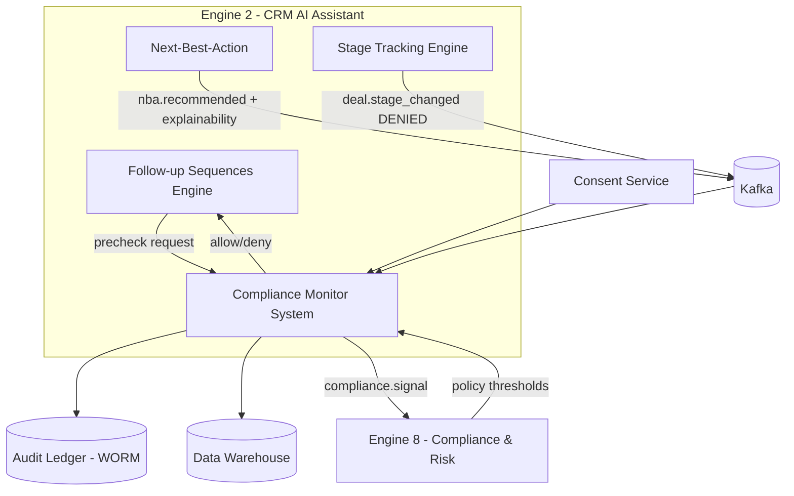
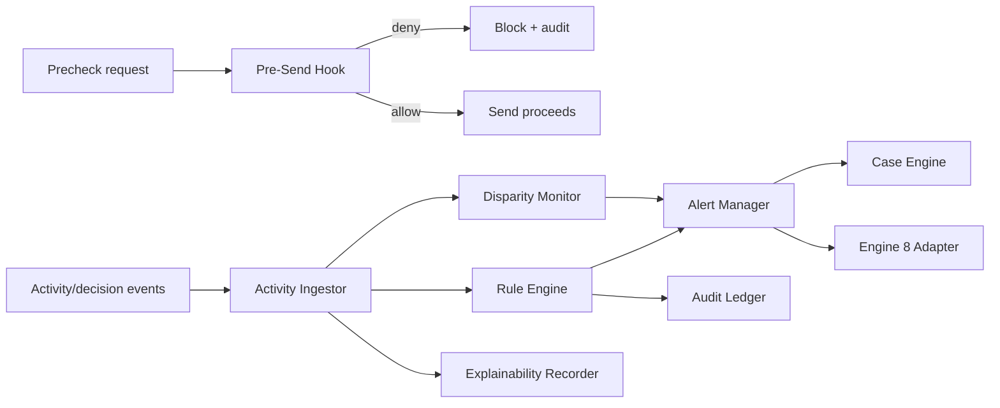
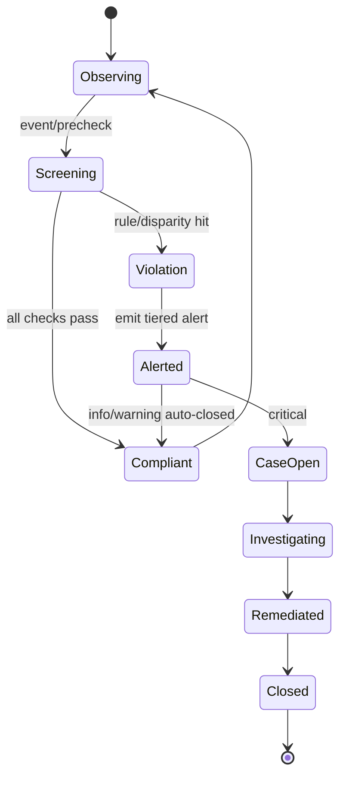
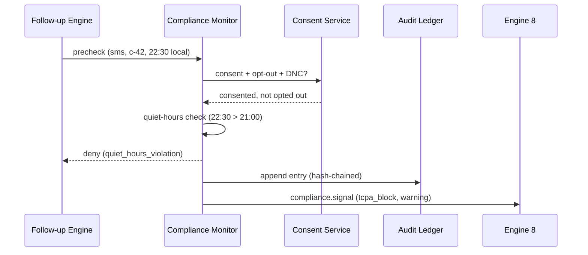

Description

Overview
A cross-cutting governance layer that ensures all CRM activities, AI decisions, communications, and data handling comply with applicable laws, regulations, and internal policies — and maintains complete, audit-ready records. Operates as middleware across all other engines rather than as a standalone feature.
Goals
Prevent regulatory penalties through proactive, automated compliance checking
Ensure all AI decisions are fair, transparent, and legally defensible
Maintain client trust through consent-driven, responsible data handling
Be always audit-ready without manual effort
Functional Requirements
Communication compliance: pre-send check for unsubscribe link, sender identity, National Do Not Call Registry (FTC)
Consent management: track opt-in/opt-out per lead per channel; block communication if opted out
Data retention policy engine: auto-anonymize or delete lead data after configurable retention period; pre-deletion alert
AI decision audit log: immutable, append-only record of every AI-driven decision with full reasoning
Fairness monitor: statistical analysis of AI outputs to detect disparate impact across demographic groups (Lead Scoring, Dynamic Pricing, Lead Assignment)
RESPA/TILA regulatory disclosure tracker: ensure required disclosures are included at correct pipeline stages
Compliance dashboard: real-time red/amber/green status for each compliance domain
Violation alert and block: immediate alert + action block when a compliance rule is breached
Audit export: complete activity log downloadable for regulatory inspection at any time
Compliance Domains
Data Privacy: Consent management, data retention, right to erasure (CCPA / state privacy laws)
Marketing: No messages to opted-out leads, FTC Do Not Call Registry check, CAN-SPAM compliance
AI Fairness: Disparate impact detection in AI outputs
Regulatory: RESPA/TILA disclosures at required pipeline stages
Audit: Immutable decision log with full explainability
Technical Notes
Architecture: middleware — communications and decisions pass through compliance check before execution
Immutable audit log: append-only event store (no modification or deletion of existing records)
Fairness analysis: statistical tests (Chi-square, disparate impact ratio) on AI output distributions by demographic group
CCPA/Privacy right-to-delete: anonymizes lead data and removes from training datasets
Acceptance Criteria
All outbound messages compliance-checked before sending
Messages to opted-out leads blocked and the block is logged
Consent status tracked per channel per lead and respected system-wide
Immutable AI decision audit log complete and exportable
Fairness monitor flags statistically biased outputs with confidence threshold
Data retention policies automatically enforced with pre-deletion alerts
Compliance dashboard shows real-time status across all monitored domains
Full audit trail exportable for regulatory inspection at any time
Dependencies
Build Dependencies: None (standalone governance framework — rules engine and compliance checks can be built independently; integration with engine outputs wired post-build)
Runtime Data Integrations: All engines (monitors and wraps all in production)
Feeds into: All engines (governance signals — can block or flag any action)

Subtasks
CEAAPSS-565
Regulatory Updates
CEAAPSS-566
Audit Trail
Subtask
CEAAPSS-651
Vision
CEAAPSS-652
Project Requirement
CEAAPSS-653
Functional Requirement
CEAAPSS-654
System Architecture
CEAAPSS-655
System Design

Regulatory Updates


Description

Overview
Manages the process of keeping all compliance rules, consent requirements, and regulatory checks current as laws and regulations change over time. Ensures the Compliance Monitor System never operates on outdated rules — and that the team is alerted when a regulatory change requires a policy update in the CRM.
Goals
Ensure compliance rules always reflect the current legal and regulatory landscape
Alert the compliance/legal team when external regulations change
Provide a structured process for reviewing, updating, and approving rule changes
Maintain a version history of all compliance rule changes for audit purposes
Functional Requirements
Regulatory change monitoring: track updates to key regulations (RESPA, TILA, FTC Do Not Call Registry, CCPA, state privacy laws)
Alert system: notify compliance officer or legal team when a tracked regulation is updated
Rule update workflow: compliance officer reviews alert → proposes rule change → approved by designated authority → deployed to Compliance Monitor System
Rule version history: every compliance rule stored with its full change history (who changed, what changed, when, approval reference)
Rule staging: proposed rule changes go to staging for review before production
Regulation tracker dashboard: list of all tracked regulations with last reviewed date and status (Current, Review Needed, Updated)
Manual rule override: authorized users can add emergency rule updates outside normal cycle
Technical Notes
Regulation monitoring: subscribe to official federal register notifications, FTC/CFPB/HUD websites, or use a legal update API where available
Rule change record: { rule_id, previous_version, new_version, changed_by, approved_by, change_reason, effective_date }
Approval workflow: two-step — proposer + approver (different users)
Staging → production deployment requires explicit approval sign-off
Acceptance Criteria
Tracked regulations are monitored and changes detected within 48 hours
Compliance officer/legal team alerted when a tracked regulation changes
Rule update workflow requires proposer and separate approver
All rule changes are version-controlled with full change history
Proposed changes go through staging before production
Regulation tracker dashboard shows status of all tracked regulations
Emergency manual rule updates are possible for authorized users
Dependencies
Depends on: CEAAPSS-564 Compliance Monitor System (rule engine to update)
Feeds into: CEAAPSS-566 Audit Trail (all rule changes logged), CEAAPSS-564 Compliance Monitor System (updated rules deployed here)


Audit Trail


Description

Overview
Maintains a complete, immutable, and searchable log of all significant system actions, AI decisions, user activities, data access events, and compliance checks across the entire CRM — providing a single source of truth for regulatory inspections, internal audits, and dispute resolution.
Goals
Be always audit-ready without any manual preparation
Provide an immutable record that cannot be altered or deleted by any user
Enable fast retrieval of any activity record during a regulatory inspection
Support dispute resolution between agents, clients, and the business
Functional Requirements
Events logged: all AI decisions with full reasoning, all user actions (login, data access, record edit, message sent, stage change), all compliance check results, all consent changes, all rule updates (from CEAAPSS-565)
Immutability: append-only log — no user (including admin) can edit or delete audit records
Search and filter: search by lead ID, agent ID, event type, date range, system/engine name
Audit record structure: who, what, when, why, outcome — for every event
Data retention: audit logs retained for configurable period (default: 7 years for regulatory compliance)
Export: full or filtered audit log downloadable as CSV or PDF for regulatory submission
Access control: audit log is read-only for all users; only specific compliance roles can export
Tamper detection: hash-chaining or equivalent to detect if records have been modified externally
Technical Notes
Storage: append-only event store (e.g., event sourcing pattern) — separate from main transactional DB
Record schema: { event_id, timestamp, actor_type, actor_id, event_type, entity_type, entity_id, action, reasoning, outcome, ip_address, session_id }
Hash chaining: each record includes hash of previous record to detect tampering
Search index: full-text + structured index on key fields for fast retrieval
Long-term storage: cold storage for records older than 1 year to manage cost
Acceptance Criteria
All defined event types are captured in the audit log automatically
No user (including admin) can edit or delete any audit record
Audit log is searchable by lead ID, agent ID, event type, and date range
Full and filtered audit log is exportable as CSV and PDF
Tamper detection mechanism is in place and verifiable
Records are retained for the configured retention period (default 7 years)
Only authorized compliance roles can access and export the audit log
Response time for audit log search is under 5 seconds for any query
Dependencies
Depends on: CEAAPSS-564 Compliance Monitor System (receives compliance check events), CEAAPSS-565 Regulatory Updates (rule change events logged here), all CRM engines (all significant actions logged)
Feeds into: CEAAPSS-564 Compliance Monitor System (complete record for regulatory inspection)

# Compliance Monitor System — Vision

## 1. Purpose & Mission
The **Compliance Monitor System** is the guardian sub-agent of Engine 2 (CRM AI Assistant). Its mission is to **continuously monitor CRM activities, communications, and AI-driven decisions for regulatory compliance** — fair-lending (ECOA/Reg B), TCPA/CAN-SPAM for outreach, required disclosures, and PII handling — producing immutable audit trails, real-time alerts, and case workflows, while coordinating with the platform-wide Engine 8 (Compliance & Risk Monitor).

It answers: *"Is everything Engine 2 just did — every message, record change, score, and recommendation — compliant; and if not, who needs to know, and what's the auditable proof?"*

## 2. Problem Statement
Lending CRM compliance is high-risk and traditionally reactive:
- Fair-lending violations hide in patterns (who gets contacted, scored, or offered what) that no human reviews at scale.
- TCPA exposure is per-message and severe; a single mis-timed SMS or post-opt-out send is a liability.
- Required disclosures (adverse-action notices within ECOA timelines) are tracked manually and missed.
- AI decisions lack consistent explainability records, undermining defensibility.
- Audit prep is a fire drill: evidence is scattered, not continuously captured.

Result: regulatory risk, fines, reputational damage, and audits that consume the org for weeks.

## 3. Target Users & Stakeholders
| Stakeholder | Use of the system |
|-------------|-------------------|
| Compliance Officers | Review alerts, manage cases, export audit evidence |
| Legal / Risk | Assess fair-lending + TCPA exposure |
| Loan Officers / Managers | Receive guardrail warnings; remediate flagged items |
| Engine 8 (platform Compliance) | Consumes Engine 2 signals; central correlation |
| Auditors (SOC 2 / regulators) | Pull immutable, complete audit trails |
| Peer sub-agents | Emit activity events; receive block/allow guardrails |

## 4. Value Proposition & Business Goals
- **Continuous, automated surveillance**: every CRM communication, decision, and record change screened in real time.
- **Fair-lending defensibility**: disparity monitoring + explainability records for ECOA/Reg B.
- **TCPA/CAN-SPAM safety net**: detects + blocks non-compliant outreach before/at send.
- **Disclosure timeliness**: tracks adverse-action and required-notice clocks; alerts before deadlines.
- **Audit-on-demand**: immutable, queryable trails replace audit fire drills.

## 5. Success Metrics & KPIs
| KPI | Target |
|-----|--------|
| Communications screened pre/at-send | 100% |
| Detection latency (activity → alert) | p95 ≤ 10 s |
| Missed TCPA quiet-hour/opt-out violations | 0 (with Follow-up engine guardrails) |
| Fair-lending disparity monitor coverage | 100% of decisioning sub-agents |
| Adverse-action notice on-time rate (ECOA 30-day) | ≥ 99.9% |
| Audit-evidence retrieval time | ≤ 5 min for any entity/timeframe |
| False-positive alert rate | ≤ 15% (tuned, triaged) |
| Audit-trail completeness + immutability | 100% |
| Mean time to remediate a critical alert | ≤ 4h |

## 6. Scope
**In Scope**
- Real-time + batch monitoring of communications, record changes, scores, and recommendations.
- Rule + ML-based detection for fair-lending disparity, TCPA/CAN-SPAM, disclosures, PII exposure.
- Immutable audit-trail capture (who/what/when/why) with explainability records for AI decisions.
- Alerting, case management, and remediation workflows.
- Bi-directional coordination with Engine 8 (signal publication + threshold/policy consumption).

**Out of Scope**
- Final legal adjudication / regulatory filing (Legal + Engine 8 platform authority).
- Owning consent data (consumes the consent service).
- Building the outreach/decision logic itself (monitors peer sub-agents).
- Credit/underwriting decisions (Engines 1/4; monitored, not made here).

## 7. Strategic Alignment
The Compliance Monitor System is Engine 2's **trust and defensibility layer**. By screening every communication, record change, and AI decision against fair-lending, TCPA, and disclosure rules — and capturing immutable, explainable audit trails — it lets CRequity.ai operate AI-driven CRM at scale without amplifying regulatory risk. It feeds Engine 8 with Engine-2-specific compliance signals for platform-wide correlation, and provides the evidence backbone for SOC 2, GDPR/CCPA, and ECOA/Reg B, directly protecting the platform's license to operate while keeping growth-oriented automation safe.

# Compliance Monitor System — Project Requirements

## 1. Overview
Defines requirements for the Compliance Monitor System: real-time and batch surveillance of Engine 2 CRM activities, communications, and AI decisions for fair-lending, TCPA/CAN-SPAM, disclosure, and PII compliance, with immutable audit trails, alerting, case management, and Engine 8 coordination.

## 2. Objectives
- Screen 100% of outbound communications pre/at-send and 100% of decisioning events.
- Detect violations within p95 ≤ 10 s and raise actionable, low-noise alerts.
- Track disclosure/adverse-action clocks with ≥99.9% on-time notice rate.
- Capture immutable, explainable audit trails retrievable in ≤5 min.
- Publish compliance signals to Engine 8 and consume central policy thresholds.

## 3. Stakeholders & Roles
| Role | Responsibility |
|------|----------------|
| Compliance Product Owner | Owns rule library + monitoring roadmap |
| Compliance Officers | Triage alerts, manage cases, export evidence |
| Legal / Risk | Define policy thresholds + escalation |
| Backend/ML Engineers | Build detectors, audit store, case engine |
| Engine 8 liaison | Align signal contracts + central correlation |
| SRE | Owns detection latency + audit durability |

## 4. Functional Scope Summary
- Activity ingestion: communications, record changes, scores, recommendations, overrides.
- Detection engine: deterministic rules + ML anomaly/disparity models.
- Domain checks: fair-lending disparity, TCPA quiet-hours/opt-out/DNC, CAN-SPAM, disclosures, PII exposure.
- Immutable audit ledger + explainability record store.
- Alerting + case management + remediation workflow.
- Engine 8 integration (signals out, thresholds/policies in).

## 5. Non-Functional Requirements
| NFR | Target / Constraint |
|-----|---------------------|
| Detection latency | p95 ≤ 10 s (streaming), batch nightly for pattern analysis |
| Throughput | ≥ 8,000 activity events/s |
| Availability | 99.95% (monitoring must not have blind spots) |
| Audit immutability | Append-only, tamper-evident (hash-chained), ≥7-year retention |
| Evidence retrieval | ≤ 5 min for any entity/timeframe |
| False-positive rate | ≤ 15% after tuning |
| Coverage | 100% of communications + decisioning events |
| Security | PII encrypted + access-logged; least-privilege RBAC |
| Compliance | ECOA/Reg B, TCPA, CAN-SPAM, GDPR/CCPA, SOC 2 |
| Recoverability | RPO ≤ 30 s, RTO ≤ 10 min; no audit-event loss |

## 6. Constraints & Assumptions
- **Constraints**: Audit ledger is append-only and tamper-evident; monitoring must not block latency-critical paths beyond agreed budgets (use pre-send hooks + async for the rest); protected-class attributes used only for disparity *monitoring*, never decisioning.
- **Assumptions**: Peer sub-agents emit complete activity events with prediction/explainability refs; consent service + Engine 8 provide policy thresholds; demographic proxies for disparity testing are governed and access-controlled.

## 7. Dependencies
| Dependency | Type | Purpose |
|------------|------|---------|
| Kafka | Platform | Activity event ingestion + signal emission |
| Engine 8 (Compliance & Risk) | Cross-engine | Central correlation + policy thresholds |
| Consent Service | Platform | Consent/DNC/opt-out facts |
| Feedback Loop System | Peer | Model explainability + fairness inputs |
| Follow-up Sequences Engine | Peer | Pre-send communication hooks |
| Audit Store (append-only) | Internal | Tamper-evident evidence |
| Data Warehouse | Platform | Batch disparity + pattern analysis |

## 8. Deliverables & Milestones
| Phase | Milestone | Deliverables |
|-------|-----------|--------------|
| P0 (Wk 1–3) | Capture | Activity schemas, immutable audit ledger (hash-chained) |
| P1 (Wk 4–7) | Rules | TCPA/CAN-SPAM + disclosure rule detectors, pre-send hook |
| P2 (Wk 8–11) | Fairness | Disparity monitoring (4/5ths), explainability records |
| P3 (Wk 12–15) | Cases | Alerting, case management, remediation workflow |
| P4 (Wk 16–19) | Integration | Engine 8 signal contracts, batch pattern analytics |
| P5 (Wk 20–22) | Hardening | Tamper-evidence proofs, load 8k/s, SOC 2 evidence |
| GA | Launch | Compliance dashboards, audit export, runbooks |

## 9. Risks & Mitigations
| Risk | Impact | Likelihood | Mitigation |
|------|--------|-----------|------------|
| Missed violation (blind spot) | Critical | Low | 100% coverage tests + dead-letter monitoring |
| Audit tampering | Critical | Low | Hash-chained, WORM storage, integrity checks |
| Alert fatigue (too many FPs) | Medium | Medium | ML tuning + severity tiers + suppression rules |
| Using protected attributes in decisioning | Critical | Low | Strict separation; monitoring-only access controls |
| Detection latency blocks sends | Medium | Medium | Fast pre-send rules + async deep analysis |
| Disclosure clock missed | High | Low | Durable timers + escalation + Engine 8 cross-check |

## 10. Acceptance Criteria
- 100% of outbound communications pass a pre-send compliance hook; any TCPA quiet-hour/opt-out violation is blocked and logged.
- A fair-lending disparity (selection-rate ratio outside 0.80–1.25) across protected cohorts raises an alert and a case.
- Every AI decision event stores an explainability record retrievable with the audit trail.
- The audit ledger is tamper-evident: any modification breaks the hash chain and is detected.
- An adverse-action scenario triggers a disclosure-deadline timer and alerts before the ECOA 30-day limit.

# Compliance Monitor System — Functional Requirements

## 1. Overview
Specifies how the Compliance Monitor System ingests activities, detects violations across compliance domains, captures immutable evidence, alerts, manages cases, and coordinates with Engine 8.

## 2. Actors
| Actor | Description |
|-------|-------------|
| Compliance Officer | Triages alerts, manages cases, exports evidence |
| Legal / Risk | Sets policies, reviews escalations |
| Loan Officer / Manager | Receives guardrail warnings; remediates |
| Peer Sub-Agents | Emit activity/decision events; consume block/allow |
| Engine 8 | Receives signals; provides policy thresholds |
| Auditor / Regulator | Reads audit trails + evidence exports |

## 3. Functional Requirements
| ID | Requirement | MoSCoW |
|----|-------------|--------|
| FR-001 | Ingest activity events (comms, record changes, scores, recommendations, overrides) | Must |
| FR-002 | Provide a synchronous pre-send compliance hook for outbound comms | Must |
| FR-003 | Evaluate TCPA quiet-hours, opt-out, DNC on every communication | Must |
| FR-004 | Evaluate CAN-SPAM requirements (unsubscribe, sender identity) on emails | Must |
| FR-005 | Monitor fair-lending disparity (selection-rate ratio) per decisioning sub-agent | Must |
| FR-006 | Track required disclosures + adverse-action timelines (ECOA 30-day) | Must |
| FR-007 | Detect PII exposure / improper handling in communications + logs | Should |
| FR-008 | Store an immutable, hash-chained audit entry per monitored event | Must |
| FR-009 | Store explainability records for AI decisions (reason codes, features) | Must |
| FR-010 | Raise tiered alerts (info/warning/critical) with context | Must |
| FR-011 | Create + manage compliance cases with status + assignment | Must |
| FR-012 | Provide remediation workflow + SLA tracking on cases | Should |
| FR-013 | Publish compliance signals to Engine 8 | Must |
| FR-014 | Consume policy thresholds/rules from Engine 8 | Must |
| FR-015 | Run batch pattern analysis (e.g., redlining-style geographic disparity) | Should |
| FR-016 | Export audit evidence packages for a given entity/timeframe | Must |
| FR-017 | Block/hold non-compliant outbound comms at the pre-send hook | Must |
| FR-018 | Verify audit-chain integrity periodically + on demand | Must |
| FR-019 | Suppress/deduplicate repeat alerts to control noise | Should |
| FR-020 | Provide dashboards for coverage, disparity, alert backlog | Should |

## 4. User Stories
**US-1 — Pre-send TCPA block**
> As a *compliance officer*, I want any SMS attempted in a contact's quiet hours or after opt-out to be blocked before it sends.
- **AC1**: The Follow-up engine's pre-send hook returns `deny` for quiet-hours/opt-out/DNC.
- **AC2**: The blocked attempt is logged immutably with the reason.

**US-2 — Fair-lending disparity alert**
> As *legal*, I want to be alerted if any sub-agent's outcomes disadvantage a protected cohort.
- **AC1**: Nightly disparity analysis computes selection-rate ratio per cohort per sub-agent.
- **AC2**: Ratio outside 0.80–1.25 raises a critical alert + case with supporting data.

**US-3 — Adverse-action deadline**
> As a *compliance officer*, I want assurance that adverse-action notices go out within ECOA's 30-day window.
- **AC1**: On `deal.stage_changed{to: DENIED}`, a disclosure timer starts.
- **AC2**: Warnings fire at T-7d and T-2d; missing notice escalates to critical.

## 5. Inputs & Outputs
**Inputs**: communication events + pre-send requests, `record.updated`, `lead.scored`, `nba.recommended`, `*.overridden`, `deal.stage_changed`, explainability refs, consent facts, Engine 8 policies.

**Outputs**: pre-send `allow/deny`, audit-ledger entries, `compliance.alert`, `compliance.case.*`, signals to Engine 8, evidence export packages, dashboards.

## 6. Business Rules
- **BR-1**: A communication failing any hard rule (quiet hours, opt-out, DNC, missing unsubscribe) is denied at pre-send.
- **BR-2**: Protected-class attributes are used only for disparity monitoring, never as decision inputs.
- **BR-3**: Every monitored event yields an immutable, hash-chained audit entry; gaps are alerts.
- **BR-4**: AI decisions without an explainability record are flagged non-compliant.
- **BR-5**: Disclosure clocks use regulatory calendars; adverse-action default = 30 days (ECOA).
- **BR-6**: Critical alerts auto-create a case and notify compliance within SLA.

## 7. Integration Points & APIs
**Consumed events**: communication/pre-send requests, `record.updated`, `lead.scored`, `nba.recommended`, `*.overridden`, `deal.stage_changed`, `consent.updated`.
**Produced events**: `compliance.alert`, `compliance.case.opened`, `compliance.case.updated`, `compliance.signal` (to Engine 8).
**REST**:
- `POST /compliance/v1/precheck` — synchronous comm screening `{channel, contact_id, content}` → `allow|deny`.
- `GET /compliance/v1/audit?entity_id=&from=&to=` — query audit trail.
- `POST /compliance/v1/audit/export` — generate evidence package.
- `GET /compliance/v1/cases/{id}` — case detail.

## 8. Error Handling & Edge Cases
- **Precheck timeout**: fail-closed for hard rules (deny) within latency budget; async deep checks continue.
- **Missing explainability ref**: flag decision; open low-severity case for the owning sub-agent.
- **Audit-chain break detected**: raise critical integrity alert; quarantine + investigate.
- **Conflicting Engine 8 policy version**: use latest signed policy; log version reconciliation.
- **Disparity small-sample**: suppress alert below minimum cohort size; flag for batch review.
- **Duplicate events**: dedupe by event id; audit records "deduped" without losing the original.
- **Alert storm**: severity-aware suppression + grouping; never suppress critical TCPA/fair-lending.

# Compliance Monitor System — System Architecture

## 1. Architecture Overview & Principles
A monitoring service combining a low-latency synchronous pre-send hook with asynchronous streaming + batch surveillance, an immutable hash-chained audit ledger, and a case-management workflow. Principles:
- **Fail-closed for hard rules**: deny risky comms within the latency budget.
- **100% coverage, no blind spots**: every comm + decision audited; gaps are alerts.
- **Tamper-evident evidence**: append-only, hash-chained audit store.
- **Monitor, don't decide**: peers act; this system observes, alerts, and (for comms) gates.

## 2. Context Diagram


## 3. Component Breakdown
| Component | Responsibility |
|-----------|----------------|
| Pre-Send Hook | Synchronous comm screening (hard rules), fail-closed |
| Activity Ingestor | Consumes async activity/decision events |
| Rule Engine | Deterministic checks: TCPA, CAN-SPAM, disclosures, PII patterns |
| Disparity Monitor | Fair-lending selection-rate-ratio analysis (batch + streaming) |
| Explainability Recorder | Stores reason codes/features for AI decisions |
| Audit Ledger | Append-only hash-chained tamper-evident store |
| Alert Manager | Tiered alerts, suppression, grouping |
| Case Engine | Case lifecycle, assignment, remediation SLAs |
| Engine 8 Adapter | Signal publication + policy ingestion |
| Evidence Exporter | Builds audit packages on demand |

## 4. Data Flow


## 5. Technology Stack
| Layer | Technology |
|-------|------------|
| Language/Runtime | Go (hook/rules), Python (disparity ML/batch) |
| Messaging | Apache Kafka |
| Stream/Batch | Kafka Streams/Flink (real-time), Spark (batch disparity) |
| Datastores | Append-only ledger (WORM/object lock), Postgres (cases), Warehouse (analytics) |
| Integrity | Hash-chaining + periodic Merkle proofs |
| API | REST via API gateway (low-latency precheck) |
| Deploy | Kubernetes + HPA |
| Observability | OpenTelemetry, Prometheus, Grafana |

## 6. Integration & Messaging
- **Consumed**: precheck requests (REST), `record.updated`, `lead.scored`, `nba.recommended`, `*.overridden`, `deal.stage_changed`, `consent.updated`, Engine 8 policies.
- **Produced**: precheck `allow/deny`, `compliance.alert`, `compliance.case.*`, `compliance.signal` to Engine 8.
- **Engine 8 contract**: standardized signal schema (rule id, severity, entity, evidence ref); policies signed + versioned.
- **Partitioning**: Kafka keyed by `entity_id` for ordered per-entity audit.

## 7. Data Stores & Feature Store
- **Audit Ledger**: append-only object storage with object-lock (WORM) + hash chain; ≥7-year retention.
- **Postgres**: cases, alert state, policy cache, disclosure timers.
- **Warehouse**: disparity analytics, geographic/redlining-style pattern tables.
- **Feature/Explainability store**: AI decision reason codes + feature snapshots references.

## 8. Security & Compliance Boundaries
- Protected-class proxies isolated in an access-controlled store, used only by the Disparity Monitor.
- Audit ledger is tamper-evident; integrity verified periodically and on export.
- PII encrypted; all access to compliance data logged (compliance-of-the-compliance-system).
- Pre-send hook enforces hard rules fail-closed; deep async checks add defense-in-depth.
- Clear separation: monitoring data never flows back into decisioning features.

## 9. Scalability & Deployment
- Pre-send hook horizontally scaled, sub-100ms p99 for hard-rule checks; deep analysis async.
- Stream processors scale on partitions; batch disparity jobs on scheduled Spark clusters.
- Ledger writes idempotent + ordered per entity; WORM storage for immutability.
- Multi-AZ; no-single-point-of-failure for the capture path (coverage guarantee).

## 10. Observability
- Metrics: precheck latency/deny rate, detection latency, coverage %, alert volume by severity, case backlog/SLA.
- Compliance dashboards: disparity ratios per sub-agent, disclosure-clock status, audit-chain integrity.
- Tracing across precheck → rule → audit → alert → case.
- Alerts: coverage gap (dropped events), audit-chain break, disclosure-deadline risk, disparity breach.

# Compliance Monitor System — System Design

## 1. Detailed Component Design
**Pre-Send Hook** — Low-latency REST endpoint called by the Follow-up Sequences Engine before any send. Runs only hard, fast rules (quiet hours by contact tz, opt-out, DNC, missing unsubscribe) against cached consent. Returns `allow|deny` with reason within the latency budget; writes an audit entry asynchronously.

**Rule Engine** — Deterministic detectors for TCPA, CAN-SPAM, disclosures, and PII pattern scanning over async activity events. Each finding produces a typed violation with severity.

**Disparity Monitor** — Computes selection-rate ratio per sub-agent across protected proxy cohorts (batch nightly + streaming approximations). Applies the 4/5ths (0.80–1.25) rule and minimum-sample guards.

**Audit Ledger** — Append-only; each entry stores `prev_hash` + `entry_hash = H(prev_hash || payload)`, forming a tamper-evident chain. Periodic Merkle root anchoring.

**Case Engine** — Converts critical alerts into cases with assignment, status, SLA timers, and remediation steps.

## 2. Data Models & Schemas
```sql
CREATE TABLE audit_ledger (
  seq          BIGSERIAL PRIMARY KEY,
  entity_id    UUID NOT NULL,
  event_type   TEXT NOT NULL,        -- comm_sent|decision|record_change|...
  actor        TEXT NOT NULL,
  payload      JSONB NOT NULL,       -- minimized, PII-tokenized
  explain_ref  TEXT,                 -- reason codes/features pointer
  prev_hash    TEXT NOT NULL,
  entry_hash   TEXT NOT NULL,        -- H(prev_hash || canonical(payload))
  created_at   TIMESTAMPTZ DEFAULT now()
);

CREATE TABLE compliance_case (
  case_id      UUID PRIMARY KEY,
  rule_id      TEXT NOT NULL,
  severity     TEXT NOT NULL,        -- info|warning|critical
  entity_id    UUID,
  status       TEXT NOT NULL,        -- open|investigating|remediated|closed
  assignee     TEXT,
  evidence_ref TEXT,
  opened_at    TIMESTAMPTZ DEFAULT now(),
  sla_due_at   TIMESTAMPTZ
);

CREATE TABLE disclosure_timer (
  deal_id      UUID PRIMARY KEY,
  kind         TEXT NOT NULL,        -- adverse_action|...
  started_at   TIMESTAMPTZ NOT NULL,
  due_at       TIMESTAMPTZ NOT NULL, -- e.g., started_at + 30d (ECOA)
  satisfied    BOOLEAN DEFAULT FALSE
);
```

Disparity result (JSON):
```json
{
  "sub_agent": "lead_scoring",
  "window": "2026-05-01..2026-05-31",
  "cohort_dimension": "geo_proxy",
  "selection_rates": {"cohort_a": 0.42, "cohort_b": 0.31},
  "ratio": 0.74,
  "passes_4_5ths": false,
  "min_sample_met": true
}
```

## 3. API Specification
**Pre-send check**
```
POST /compliance/v1/precheck
{ "channel": "sms", "contact_id": "c-42", "content": "Rate update...",
  "scheduled_for": "2026-06-15T22:30:00-04:00" }
```
Deny response:
```json
{ "decision": "deny", "reasons": ["quiet_hours_violation"], "audit_seq": 884221 }
```

**Query audit trail**
```
GET /compliance/v1/audit?entity_id=deal-204&from=2026-06-01&to=2026-06-15
```
```json
{
  "entity_id": "deal-204",
  "entries": [
    {"seq": 880013, "event_type": "decision", "actor": "next_best_action",
     "explain_ref": "expl://p-7781", "entry_hash": "a91f..."}
  ],
  "chain_verified": true
}
```

## 4. Workflow / Algorithm Design


Audit-chain verification: recompute `entry_hash` from `prev_hash || canonical(payload)` across a range; any mismatch flags tampering at that `seq`.

## 5. Sequence Diagram


## 6. Database / Storage Schema
- **Audit Ledger**: WORM object storage + Postgres index (`audit_ledger`) with hash chain.
- **Postgres**: `compliance_case`, `disclosure_timer`, `alert`, `policy_cache`.
- **Warehouse**: `fact_disparity`, `fact_violation`, geographic pattern tables.
- **Explainability store**: reason-code/feature snapshots referenced by `explain_ref`.

## 7. Configuration & Parameters
| Parameter | Default | Purpose |
|-----------|---------|---------|
| `precheck_latency_budget_ms` | 80 | Hard-rule synchronous budget |
| `fairness_ratio_band` | 0.80–1.25 | 4/5ths disparity gate |
| `disparity_min_sample` | 100 | Suppress small-sample alerts |
| `adverse_action_days` | 30 | ECOA disclosure window |
| `disclosure_warn_offsets` | 7d,2d | Pre-deadline warnings |
| `chain_verify_interval_min` | 30 | Integrity check cadence |

## 8. Testing Strategy
- **Pre-send tests**: fuzz timezones/opt-out states → correct deny within budget.
- **Coverage tests**: every comm + decision event yields exactly one audit entry; dropped events alert.
- **Tamper tests**: mutate a payload → chain verification detects the break at the right seq.
- **Disparity tests**: synthetic cohorts validate ratio math + 4/5ths + min-sample suppression.
- **Disclosure-clock tests**: timers fire warnings/escalations at correct offsets.
- **Load**: 8k events/s with precheck p99 < 100 ms.

## 9. Performance & Reliability Considerations
- Two-tier design: fast synchronous hard rules + async deep analysis avoids blocking sends while keeping coverage.
- Consent cached with short TTL for fast, safe opt-out enforcement at pre-send.
- Hash-chained WORM ledger guarantees tamper-evidence and audit completeness.
- Idempotent, per-entity-ordered ingestion prevents gaps and double-audit.
- Severity-aware alert suppression controls noise while never suppressing critical TCPA/fair-lending findings.
