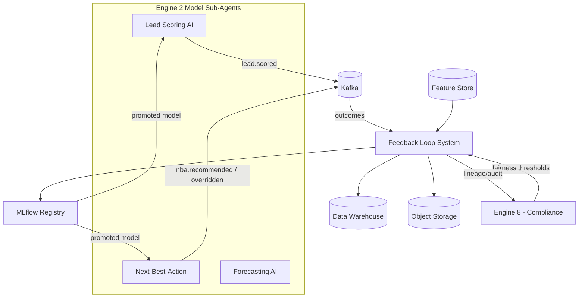
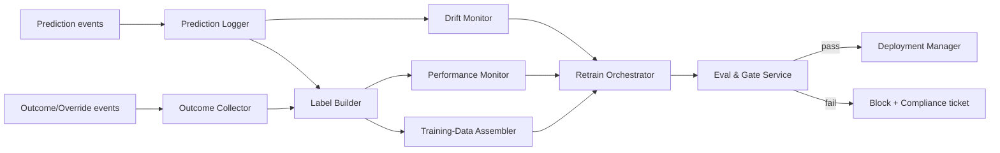
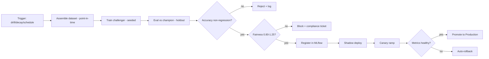
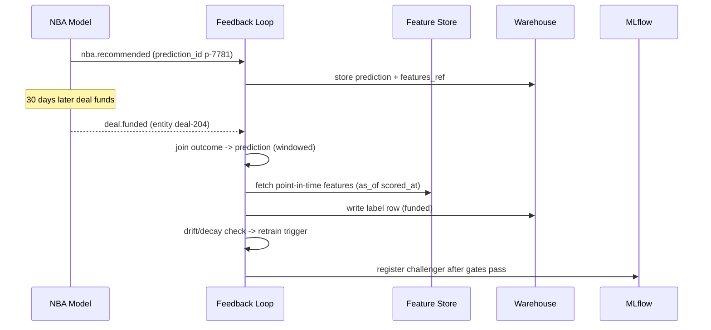

# Feedback Loop System (Ticket Description)

Description

Overview
Captures the outcomes of all AI recommendations and automated actions across every engine in the CRM, using that data to continuously retrain and improve model accuracy over time. Without this, AI engines degrade silently as market conditions change. With it, the system gets measurably smarter as the team uses it.
Goals
Create a self-improving AI system that gets more accurate over time
Track and prevent silent model performance degradation
Build a proprietary labeled training dataset as a long-term competitive asset
Create accountability for the performance of each AI engine
Functional Requirements
Explicit feedback: agent thumbs up/down on AI recommendations (NBA, Lead Score, Churn Risk, Product Match)
Implicit feedback: automatic outcome tracking — did the recommended action lead to a response, stage progression, or conversion?
Outcome labeling: label each recommendation as successful or unsuccessful based on measurable downstream results
Model performance dashboard: precision, recall, F1 score, and AUC per AI engine over time
Retraining pipeline: labeled data → feature store → model retraining → evaluation → production deployment
Accuracy alert: fires when any engine drops below configurable performance threshold
Labeled dataset export: clean, structured data available for model training and audit
A/B test framework: test new model versions against current before full rollout
Technical Notes
Event schema: { recommendation_id, engine_name, recommendation, context_snapshot, action_taken, outcome, label, timestamp }
Outcome observation windows: 7 days (message response), 30 days (stage progression), 90 days (conversion)
MLOps pipeline: data validation → feature engineering → model training → staging evaluation → production
Feedback store: separate from transactional DB, read-optimized for ML workloads
Acceptance Criteria
Agent explicit feedback captured for all AI recommendations
Implicit outcome labels auto-generated for all recommendations with measurable outcomes
Model performance metrics (precision, recall, AUC) visible per engine in real time
Retraining pipeline triggers automatically when accuracy drops below threshold
Feedback data cleanly formatted and exportable for training
Alert fires when any engine's accuracy drops significantly vs baseline
Dependencies
Build Dependencies: Lead Scoring AI (CEAAPSS-567), Churn Prediction AI (CEAAPSS-568), Next-Best-Action Engine (CEAAPSS-569), Product Matching AI (CEAAPSS-570)
Runtime Data Integrations: All AI engines emit recommendation + outcome events consumed by this system
Feeds into: All AI engines (retraining improves all)

Subtasks
CEAAPSS-559
Model Retraining
CEAAPSS-560
A/B Testing Framework
CEAAPSS-641
Vision
CEAAPSS-642
Project Requirement
CEAAPSS-643
Functional Requirement
CEAAPSS-644
System Architecture
CEAAPSS-645
System Design

Model Retraining


Description

Overview
Handles the automated pipeline that takes labeled feedback data collected by the Feedback Loop System and uses it to retrain AI models — ensuring every engine in the CRM (Lead Scoring, Churn Prediction, NBA, etc.) stays accurate over time as market conditions and lead behavior evolve.
Goals
Automatically retrain AI models when performance drops below threshold
Prevent silent model degradation over time
Ensure retraining uses only clean, validated labeled data
Deploy retrained models safely with rollback capability if performance regresses
Functional Requirements
Retraining trigger conditions: (1) model accuracy drops below configurable threshold, (2) scheduled monthly cycle, (3) manually triggered by ML team
Data pipeline: pull labeled feedback data → validate quality → apply feature engineering → feed into model training job
Model evaluation before deployment: new model must outperform current model on held-out test set before going live
Staging environment: retrained model runs in staging and is evaluated before production promotion
Rollback mechanism: if retrained model underperforms in production, auto-revert to previous version
Retraining log: record trigger reason, training data size, evaluation metrics, deployment decision per cycle
Notification to ML team on retraining start, completion, and deployment outcome
Technical Notes
MLOps pipeline: data validation → feature store → training job → evaluation → staging → production
Model registry: version-controlled storage of all model versions with their evaluation metrics
Evaluation metrics per engine: accuracy, precision, recall, F1, AUC depending on model type
Training data minimum threshold: require at least N labeled samples before triggering retraining
Infrastructure: can run as scheduled batch job or event-triggered pipeline
Acceptance Criteria
Retraining pipeline triggers automatically when accuracy drops below defined threshold
Monthly scheduled retraining cycle runs without manual intervention
New model is evaluated against current model before any deployment
Staging evaluation must pass before production promotion
Rollback to previous model version works within 15 minutes if needed
Full retraining log is stored per cycle (trigger, data size, metrics, outcome)
ML team is notified at each stage of the pipeline
Dependencies
Depends on: CEAAPSS-558 Feedback Loop System (labeled training data source)
Feeds into: All AI engines (Lead Scoring, Churn Prediction, NBA, Product Matching, etc.)

A/B Testing Framework


Description

Overview
Provides a structured framework for running controlled experiments — testing new AI model versions, message variants, sequence structures, or offer types against the current baseline to determine which performs better before any full rollout. Prevents untested changes from being deployed to all leads at once.
Goals
Validate AI model improvements with statistical evidence before full deployment
Test message and offer variants to identify what drives higher engagement and conversion
Prevent poorly performing changes from affecting the entire lead base
Build a culture of evidence-based decision making across the CRM
Functional Requirements
Experiment configuration: define test name, hypothesis, variants (control vs challenger), traffic split %, audience segment, success metric, and minimum run duration
Traffic splitting: route a defined % of leads/interactions to each variant automatically
Supported experiment types:
Model A/B test: current model vs retrained model
Message variant test: different subject lines, message content, or CTAs
Sequence structure test: different step order or timing
Offer variant test: different incentive types or values
Statistical significance calculation: flag when results are statistically significant (p-value threshold configurable)
Early stopping rules: stop experiment if one variant is clearly underperforming (guardrail metric breached)
Results dashboard: conversion rate, engagement rate, and statistical significance per variant
Winner promotion: one-click promotion of winning variant to 100% traffic
Experiment history log: all past experiments with results and decisions
Technical Notes
Traffic allocation: consistent hashing on lead_id to ensure same lead always sees same variant
Minimum sample size calculation before declaring significance (power analysis)
Metrics tracked per variant: primary success metric + guardrail metrics (to prevent optimizing one thing at the cost of another)
Results stored: { experiment_id, variant, lead_id, metric_value, timestamp }
Acceptance Criteria
Experiments can be configured without code changes (admin UI or config)
Traffic split is consistent — same lead always sees the same variant
Statistical significance is calculated and displayed in real time
Early stopping fires when a guardrail metric is breached
Results dashboard shows per-variant metrics with significance indicator
Winner can be promoted to 100% traffic with one action
All experiment history and results are stored and auditable
Dependencies
Depends on: CEAAPSS-558 Feedback Loop System (outcome tracking), CEAAPSS-559 Model Retraining (model variants to test)
Feeds into: All AI engines and messaging systems (winning variants deployed to all)

# Feedback Loop System — Vision

## 1. Purpose & Mission
The **Feedback Loop System** is the MLOps backbone of Engine 2 (CRM AI Assistant). Its mission is to **close the learning loop** for every model-driven sub-agent — capturing ground-truth outcomes (won/lost, funded/fell-out), human overrides, and explicit user feedback, then transforming them into labeled training data, drift signals, and automated retraining triggers that continuously improve Lead Scoring, NBA, Forecasting, Churn, Timing, and other models.

It answers: *"Were our AI predictions and recommendations actually right, where were they wrong, and how do we feed that truth back to make every Engine 2 model better — safely and reproducibly?"*

## 2. Problem Statement
AI models in lending degrade silently without a disciplined feedback loop:
- Outcomes (a deal that funded or fell out 45 days later) are never linked back to the prediction that scored it.
- Loan officers override AI recommendations, but those overrides — the richest signal — vanish unlabeled.
- Drift (rate environment shifts, new borrower mix) goes undetected until conversion craters.
- Retraining is manual, ad hoc, and not reproducible; no one can prove which data trained which model (a SOC 2 + fair-lending problem).
- There's no governed gate ensuring a retrained model is better and fair before it replaces production.

Result: stale, drifting, undefendable models and eroding trust in Engine 2's intelligence.

## 3. Target Users & Stakeholders
| Stakeholder | Use of the system |
|-------------|-------------------|
| ML Engineers / Data Scientists | Get labeled datasets, drift alerts, retraining pipelines |
| MLOps / Platform | Govern model registry, deployment gates, lineage |
| Peer model sub-agents | Consume improved models; emit predictions + overrides |
| Sales Managers / RevOps | See feedback impact on conversion and model quality |
| Compliance (Engine 8) | Audit training-data lineage + fairness gates |
| Loan Officers | Provide override/feedback signals (implicitly + explicitly) |

## 4. Value Proposition & Business Goals
- **Continuous improvement**: predictions are matched to outcomes and recycled into training.
- **Override mining**: human corrections become high-value labels, not lost clicks.
- **Drift early-warning**: PSI/performance monitors trigger retraining before quality drops.
- **Reproducible MLOps**: every model has full lineage (data → features → training → eval → deploy).
- **Governed promotion**: no model ships without passing accuracy AND fairness gates.

## 5. Success Metrics & KPIs
| KPI | Target |
|-----|--------|
| Prediction→outcome label match rate | ≥ 95% of decisioned entities |
| Outcome labeling latency (event → label available) | ≤ 24h for fast labels; ≤ 60d windowed for funded |
| Override capture completeness | ≥ 99% of AI recommendations |
| Drift detection lead time before KPI degradation | ≥ 2 weeks |
| Automated retrain trigger accuracy (justified retrains) | ≥ 90% |
| Model promotion gate pass requires fairness check | 100% (hard gate) |
| Training-data lineage completeness | 100% reproducible |
| Post-retrain conversion lift (vs. incumbent, A/B) | measurable +, never negative at ship |

## 6. Scope
**In Scope**
- Capture of outcomes, overrides, and explicit feedback from all Engine 2 sub-agents.
- Label generation (immediate + windowed/delayed labels with attribution to prediction id).
- Feature/prediction logging and join to outcomes (training-data assembly).
- Drift + performance monitoring (PSI, AUC decay, calibration) and retrain triggers.
- Automated, reproducible retraining pipelines + model registry (MLflow) integration.
- Champion/challenger, shadow, and canary deployment with fairness gates.

**Out of Scope**
- The *business logic* of each consumer model (owned by each sub-agent).
- Real-time inference serving (owned by each model service).
- Final fair-lending adjudication (Engine 8; this system enforces gates + supplies lineage).
- Raw data ingestion from source systems (handled upstream).

## 7. Strategic Alignment
The Feedback Loop System is the **flywheel** that keeps Engine 2 intelligent over time. By linking every `*.recommended` / `*.scored` prediction to its real-world outcome and capturing human overrides, it produces the labeled data and drift signals that drive reproducible retraining and governed promotion. This turns CRequity.ai's CRM models into compounding assets — improving conversion and forecast accuracy while guaranteeing every model is explainable, lineage-tracked, and fairness-gated for SOC 2, GDPR/CCPA, and ECOA/Reg B defensibility.

# Feedback Loop System — Project Requirements

## 1. Overview
Defines requirements for the Feedback Loop System: the MLOps platform that captures outcomes/overrides/feedback, assembles labeled training data, detects drift, and drives reproducible retraining and governed promotion for Engine 2's model sub-agents.

## 2. Objectives
- Link ≥95% of model predictions to ground-truth outcomes via stable prediction ids.
- Capture ≥99% of human overrides as labeled feedback.
- Detect drift ≥2 weeks before KPI degradation and trigger justified retrains.
- Guarantee 100% reproducible training-data lineage.
- Enforce accuracy + fairness promotion gates before any model ships.

## 3. Stakeholders & Roles
| Role | Responsibility |
|------|----------------|
| ML Platform Owner | Owns MLOps roadmap, registry, gates |
| Data Scientists | Build/own consumer models; consume datasets |
| MLOps Engineers | Build pipelines, monitors, deployment automation |
| Data Engineers | Maintain prediction/outcome logging + joins |
| Compliance liaison (Engine 8) | Defines fairness gates + lineage requirements |
| SRE | Owns pipeline reliability + serving rollout safety |

## 4. Functional Scope Summary
- Prediction logging (model id, version, features hash, prediction id).
- Outcome capture (immediate + windowed) and override/feedback capture.
- Label store + training-data assembly with point-in-time correctness.
- Drift/performance monitors (PSI, AUC, calibration) + retrain triggers.
- Retraining pipeline orchestration + MLflow registry + lineage.
- Champion/challenger, shadow, canary, fairness gating, rollback.

## 5. Non-Functional Requirements
| NFR | Target / Constraint |
|-----|---------------------|
| Prediction log ingestion | ≥ 10,000 predictions/s |
| Label join correctness | Point-in-time accurate (no leakage) |
| Outcome match rate | ≥ 95% |
| Drift evaluation cadence | Hourly streaming + daily batch |
| Retraining pipeline reproducibility | Bit-for-bit dataset + seed pinning |
| Lineage completeness | 100% (data→features→model→eval→deploy) |
| Promotion gate | Accuracy non-regression + fairness within 4/5ths |
| Availability (capture path) | 99.9% (never drop feedback) |
| Security | PII pseudonymized in training store; encrypted at rest |
| Compliance | SOC 2, GDPR/CCPA (right-to-erasure propagation), ECOA fairness |
| Recoverability | RPO ≤ 1 min on capture; pipelines re-runnable |

## 6. Constraints & Assumptions
- **Constraints**: Must use platform feature store, MLflow registry, and data warehouse; training data pseudonymized; right-to-erasure must propagate to training sets; no protected-class attributes as direct features.
- **Assumptions**: Each model sub-agent emits predictions with a stable `prediction_id` + `features_snapshot_ref`; outcome events (`deal.funded`, `deal.lost`) are reliably published; Engine 8 provides fairness thresholds.

## 7. Dependencies
| Dependency | Type | Purpose |
|------------|------|---------|
| Kafka | Platform | Prediction, override, outcome event streams |
| Feature Store | Platform | Point-in-time feature snapshots |
| MLflow Registry | Platform | Model versioning + lineage |
| Data Warehouse | Platform | Label store + training-data assembly |
| Orchestration (Airflow/Temporal) | Platform | Retraining pipeline scheduling |
| Object Storage (S3) | Platform | Datasets, model artifacts |
| Engine 8 (Compliance) | Cross-engine | Fairness gate thresholds + audit |

## 8. Deliverables & Milestones
| Phase | Milestone | Deliverables |
|-------|-----------|--------------|
| P0 (Wk 1–4) | Capture | Prediction/override/outcome schemas + ingestion |
| P1 (Wk 5–8) | Labels | Label store, windowed labels, point-in-time joins |
| P2 (Wk 9–12) | Monitoring | Drift (PSI), performance, calibration monitors + triggers |
| P3 (Wk 13–17) | Retraining | Reproducible pipelines, MLflow lineage, eval harness |
| P4 (Wk 18–22) | Promotion | Champion/challenger, shadow/canary, fairness gates, rollback |
| GA | Launch | MLOps dashboards, runbooks, model cards |

## 9. Risks & Mitigations
| Risk | Impact | Likelihood | Mitigation |
|------|--------|-----------|------------|
| Label leakage (future data in features) | Critical | Medium | Strict point-in-time joins + leakage tests |
| Feedback loop bias (model trains on its own choices) | High | Medium | Exploration logging, propensity weighting, holdout |
| Drift false positives → needless retrains | Medium | Medium | Multi-signal triggers + human confirm for major retrains |
| Right-to-erasure not propagated to training data | Critical | Low | Erasure pipeline + lineage-driven re-derivation |
| Unfair model promoted | Critical | Low | Hard fairness gate (4/5ths) + disparity tests |
| Non-reproducible training | High | Low | Seed/data/version pinning + artifact hashing |

## 10. Acceptance Criteria
- A funded/lost outcome is joined to its originating prediction id with point-in-time-correct features (no leakage), ≥95% match rate.
- An LO override of an NBA recommendation is captured as a labeled feedback record within ≤5 s.
- A PSI breach on a key feature triggers a drift alert and a retrain candidate within the configured window.
- A retrained model cannot be promoted unless it passes accuracy non-regression AND fairness (selection-rate ratio within 0.80–1.25).
- Any model in production can produce a complete lineage report (data → features → training run → eval → deploy).

# Feedback Loop System — Functional Requirements

## 1. Overview
Specifies how the Feedback Loop System captures predictions, outcomes, overrides, and feedback; assembles labeled datasets; monitors drift; and orchestrates reproducible retraining and governed promotion.

## 2. Actors
| Actor | Description |
|-------|-------------|
| Model Sub-Agent | Emits predictions + consumes improved models |
| Loan Officer | Generates overrides + explicit feedback |
| Data Scientist | Triggers/reviews retraining; reads datasets |
| MLOps Engineer | Manages pipelines, gates, deployments |
| Compliance Reviewer | Validates fairness gates + lineage |
| Scheduler | Runs drift evals + scheduled retrains |

## 3. Functional Requirements
| ID | Requirement | MoSCoW |
|----|-------------|--------|
| FR-001 | Ingest prediction logs `{prediction_id, model, version, features_ref, output}` | Must |
| FR-002 | Capture immediate outcomes (e.g., `email.replied`) as labels | Must |
| FR-003 | Capture windowed/delayed outcomes (e.g., `deal.funded` at 60d) | Must |
| FR-004 | Capture human overrides with before/after + reason | Must |
| FR-005 | Capture explicit user feedback (thumbs, ratings, corrections) | Should |
| FR-006 | Join predictions↔outcomes with point-in-time correctness | Must |
| FR-007 | Assemble versioned training datasets with lineage | Must |
| FR-008 | Compute drift metrics (PSI) per feature on schedule | Must |
| FR-009 | Compute performance decay (AUC, calibration ECE) vs. labels | Must |
| FR-010 | Trigger retrain candidates on drift/decay/volume thresholds | Must |
| FR-011 | Orchestrate reproducible retraining pipelines (seeded) | Must |
| FR-012 | Register models + artifacts + metrics in MLflow with lineage | Must |
| FR-013 | Run challenger eval vs. champion on holdout | Must |
| FR-014 | Enforce fairness gate (selection-rate ratio 0.80–1.25) before promote | Must |
| FR-015 | Support shadow + canary deployment with auto-rollback | Must |
| FR-016 | Apply propensity/exploration weighting to mitigate feedback bias | Should |
| FR-017 | Propagate right-to-erasure deletions into training datasets | Must |
| FR-018 | Expose API to query model lineage + feedback stats | Must |
| FR-019 | Generate model cards per promoted model | Should |
| FR-020 | Alert on label match-rate drop or capture gaps | Should |

## 4. User Stories
**US-1 — Override becomes a label**
> As a *data scientist*, I want LO overrides of NBA recommendations captured as labeled examples so the next model learns from human judgment.
- **AC1**: On `nba.overridden`, a feedback record links `prediction_id`, original output, chosen action, and reason.
- **AC2**: The record is included (propensity-weighted) in the next training dataset.

**US-2 — Drift triggers retrain**
> As an *MLOps engineer*, I want automatic retraining when a key feature drifts, but not on noise.
- **AC1**: PSI > 0.2 on a top feature for 2 consecutive evals raises a retrain candidate.
- **AC2**: Major model retrains require human confirmation; minor refreshes can auto-run.

**US-3 — Fair promotion**
> As a *compliance reviewer*, I want assurance that no model ships unless it's fair.
- **AC1**: Promotion is blocked if selection-rate ratio across protected proxy cohorts is outside 0.80–1.25.
- **AC2**: The gate result + lineage are recorded on the model card.

## 5. Inputs & Outputs
**Inputs**: `*.scored` / `*.recommended` prediction events, `*.overridden` events, outcome events (`deal.funded`, `deal.lost`, `email.replied`), explicit feedback, feature snapshots, fairness thresholds.

**Outputs**: labeled datasets, drift/performance alerts, retrain candidates, registered models, eval reports, fairness-gate results, model cards, lineage reports.

## 6. Business Rules
- **BR-1**: Every label must join to a prediction via stable `prediction_id`; orphans are quarantined, not guessed.
- **BR-2**: Features for training use point-in-time snapshots (as known at prediction time) — no future leakage.
- **BR-3**: No protected-class attribute is used as a direct training feature; proxies are monitored.
- **BR-4**: A model fails promotion if accuracy regresses or fairness ratio breaches 0.80–1.25.
- **BR-5**: Right-to-erasure removes a subject from all derivable training datasets within SLA; affected models re-derived/flagged.
- **BR-6**: Auto-retrain allowed only for low-risk refreshes; high-impact models require human sign-off.

## 7. Integration Points & APIs
**Consumed events**: `lead.scored`, `nba.recommended`, `nba.overridden`, `forecast.produced`, `deal.funded`, `deal.lost`, `email.replied`, `consent.erasure_requested`.
**Produced events**: `feedback.captured`, `drift.detected`, `retrain.triggered`, `model.promoted`, `model.rolled_back`.
**REST**:
- `POST /feedback/v1/predictions` — log a prediction.
- `POST /feedback/v1/feedback` — submit override/explicit feedback.
- `GET /feedback/v1/models/{id}/lineage` — lineage report.
- `POST /feedback/v1/retrain/{model}` — trigger a retrain run.

## 8. Error Handling & Edge Cases
- **Orphan outcome (no matching prediction)**: quarantine + alert; never fabricate labels.
- **Late outcome past window**: append as out-of-window label; flag for analysis, not training-by-default.
- **Feature snapshot missing**: exclude example from training (logged) rather than impute future data.
- **Drift false alarm**: multi-signal + 2-eval persistence before triggering.
- **Pipeline non-determinism**: fail the run if artifact hash differs from pinned expectation.
- **Erasure mid-training**: cancel/rerun pipeline excluding erased subjects.
- **Fairness gate fail**: block promotion, keep champion, open compliance ticket.

# Feedback Loop System — System Architecture

## 1. Architecture Overview & Principles
A streaming + batch MLOps platform that captures predictions/outcomes/overrides, assembles point-in-time-correct labeled data, monitors drift, and orchestrates reproducible retraining with governed, fairness-gated promotion. Principles:
- **Never drop feedback**: capture path is highly available and durable.
- **Point-in-time correctness**: no label leakage, ever.
- **Reproducible by construction**: pinned data + seeds + artifact hashing.
- **Governed promotion**: accuracy + fairness gates are mandatory.

## 2. Context Diagram


## 3. Component Breakdown
| Component | Responsibility |
|-----------|----------------|
| Prediction Logger | Ingests prediction events → prediction store |
| Outcome/Feedback Collector | Captures outcomes, overrides, explicit feedback |
| Label Builder | Joins predictions↔outcomes point-in-time; builds labels |
| Training-Data Assembler | Versioned dataset materialization with lineage |
| Drift Monitor | PSI/feature distribution + population stability |
| Performance Monitor | AUC/decay/calibration vs. labels |
| Retrain Orchestrator | Triggers + runs reproducible pipelines |
| Eval & Gate Service | Challenger eval + accuracy/fairness gates |
| Deployment Manager | Shadow/canary rollout + auto-rollback |
| Lineage/Registry Adapter | MLflow integration + model cards |

## 4. Data Flow


## 5. Technology Stack
| Layer | Technology |
|-------|------------|
| Streaming | Kafka + stream processor (Flink/Kafka Streams) |
| Batch / pipelines | Airflow or Temporal + Spark |
| Datastores | Data warehouse (labels), Postgres (metadata), S3 (datasets/artifacts) |
| Feature Store | Platform feature store (point-in-time) |
| Registry | MLflow (models, metrics, lineage) |
| ML frameworks | scikit-learn / XGBoost / PyTorch |
| Serving rollout | Kubernetes + model serving (shadow/canary) |
| Observability | Prometheus, Grafana, Evidently-style drift dashboards |

## 6. Integration & Messaging
- **Consumed**: prediction events (`*.scored`, `*.recommended`), `*.overridden`, outcomes (`deal.funded`, `deal.lost`, `email.replied`), `consent.erasure_requested`.
- **Produced**: `feedback.captured`, `drift.detected`, `retrain.triggered`, `model.promoted`, `model.rolled_back`.
- **Registry hand-off**: promoted models published to MLflow; serving services pull by stage tag (`Production`/`Staging`).
- **Feature store**: read with `as_of` timestamps for point-in-time training joins.

## 7. Data Stores & Feature Store
- **Warehouse**: `predictions`, `labels`, `training_datasets`, `model_metrics` (large analytical).
- **Postgres**: pipeline metadata, gate results, lineage edges.
- **S3**: materialized dataset snapshots, model artifacts (hashed).
- **Feature Store**: historical feature values keyed by entity + timestamp for leakage-free joins.

## 8. Security & Compliance Boundaries
- Training data pseudonymized; direct PII tokenized; protected-class attributes excluded as features.
- Right-to-erasure pipeline removes subjects from datasets via lineage and re-derives/flags affected models.
- Fairness gate (Engine 8 thresholds) is mandatory and recorded on the model card.
- Full lineage (data → features → run → eval → deploy) retained for SOC 2 + ECOA audit.
- Access to datasets/registry via RBAC; all promotions audited.

## 9. Scalability & Deployment
- Streaming capture scales on partitions (keyed by entity); batch assembly on Spark clusters.
- Pipelines containerized + seeded; artifact hashing enforces reproducibility.
- Shadow deployments score live traffic without acting; canary ramps with auto-rollback on metric regression.
- Multi-AZ; warehouse + S3 durability; idempotent ingestion to avoid double-counting.

## 10. Observability
- Metrics: ingestion lag, label match-rate, drift PSI per feature, AUC/ECE trends, retrain frequency, gate pass/fail.
- Dashboards: per-model health, dataset versions, fairness ratios, deployment status.
- Alerts: match-rate drop, capture gap, drift breach, fairness-gate failure, rollback events.
- Tracing across capture → label → train → eval → deploy with lineage ids.

# Feedback Loop System — System Design

## 1. Detailed Component Design
**Prediction Logger** — Consumes prediction events and persists `{prediction_id, model, version, features_ref, output, scored_at}` to the prediction store. `features_ref` points to the immutable feature snapshot used at inference (the leakage-prevention anchor).

**Label Builder** — Streaming + batch. Matches outcome events to predictions by `prediction_id` (immediate labels) or by entity + time window (delayed labels, e.g., `deal.funded` within 60d). Emits label rows joined to the point-in-time `features_ref`.

**Drift Monitor** — Computes PSI per feature comparing the live serving distribution to the training reference; persists time series and raises `drift.detected` on sustained breach.

**Retrain Orchestrator** — On trigger, launches a seeded pipeline: assemble dataset → train → eval → gate. Pins data snapshot id, code version, hyperparameters, and random seed; verifies artifact hash for reproducibility.

**Eval & Gate Service** — Evaluates challenger vs. champion on a frozen holdout; runs the fairness gate; only on pass does the Deployment Manager promote.

## 2. Data Models & Schemas
```sql
CREATE TABLE predictions (
  prediction_id  UUID PRIMARY KEY,
  model          TEXT NOT NULL,
  model_version  TEXT NOT NULL,
  entity_id      UUID NOT NULL,      -- lead/deal/contact
  features_ref   TEXT NOT NULL,      -- feature-store snapshot pointer
  output         JSONB NOT NULL,     -- score/recommendation
  scored_at      TIMESTAMPTZ NOT NULL
);

CREATE TABLE labels (
  label_id       BIGSERIAL PRIMARY KEY,
  prediction_id  UUID REFERENCES predictions(prediction_id),
  label_type     TEXT NOT NULL,      -- funded|lost|replied|override
  label_value    JSONB NOT NULL,
  label_source   TEXT NOT NULL,      -- outcome_event|human_override|explicit
  observed_at    TIMESTAMPTZ NOT NULL,
  in_window      BOOLEAN NOT NULL
);

CREATE TABLE training_datasets (
  dataset_id     UUID PRIMARY KEY,
  model          TEXT NOT NULL,
  snapshot_uri   TEXT NOT NULL,      -- S3 immutable
  row_count      BIGINT,
  feature_set    JSONB,
  created_at     TIMESTAMPTZ DEFAULT now(),
  lineage        JSONB               -- source predictions/labels/feature versions
);
```

Feedback (override) event example:
```json
{
  "event": "nba.overridden",
  "prediction_id": "p-7781",
  "entity_id": "deal-204",
  "model": "next_best_action",
  "original_output": {"action": "send_rate_quote"},
  "chosen_action": "schedule_call",
  "reason": "borrower requested call",
  "actor": "lo:mike",
  "occurred_at": "2026-06-15T18:22:00Z"
}
```

## 3. API Specification
**Log a prediction**
```
POST /feedback/v1/predictions
{ "prediction_id": "p-7781", "model": "next_best_action", "model_version": "3.2.1",
  "entity_id": "deal-204", "features_ref": "fs://snap/2026-06-15T18:00Z/deal-204",
  "output": {"action": "send_rate_quote", "p": 0.71} }
```
```json
{ "status": "logged", "prediction_id": "p-7781" }
```

**Get model lineage**
```
GET /feedback/v1/models/next_best_action@3.3.0/lineage
```
```json
{
  "model": "next_best_action", "version": "3.3.0",
  "training_dataset": "ds-991", "snapshot_uri": "s3://.../ds-991.parquet",
  "feature_versions": ["fs:engagement@v12", "fs:deal@v7"],
  "eval": {"auc": 0.84, "ece": 0.04, "fairness_ratio": 0.93},
  "promoted_at": "2026-06-14T09:00:00Z", "gate": "passed"
}
```

## 4. MLOps / Retraining Pipeline Design


## 5. Sequence Diagram


## 6. Database / Storage Schema
- **Warehouse**: `predictions`, `labels`, `training_datasets`, `model_metrics`, `drift_timeseries`.
- **Postgres**: pipeline runs, gate results, lineage edges, retrain triggers.
- **S3**: immutable dataset snapshots + model artifacts (content-hashed paths).
- **Feature Store**: `as_of` historical reads for leakage-free joins.

## 7. Configuration & Parameters
| Parameter | Default | Purpose |
|-----------|---------|---------|
| `psi_threshold` | 0.2 | Drift trigger per feature |
| `drift_persistence_evals` | 2 | Consecutive breaches before trigger |
| `funded_label_window_days` | 60 | Delayed-label window |
| `fairness_ratio_band` | 0.80–1.25 | Promotion fairness gate |
| `canary_ramp_steps` | 1%,5%,25%,100% | Rollout schedule |
| `auto_retrain_risk_class` | low | Models eligible for auto-retrain |

## 8. Testing Strategy
- **Leakage tests**: assert features used postdate-free relative to `scored_at`.
- **Join correctness**: synthetic prediction/outcome pairs verify match-rate + windowing.
- **Reproducibility**: rerun pipeline → identical dataset + artifact hashes.
- **Gate tests**: regressed/unfair challenger is blocked; fair improvement promotes.
- **Bias mitigation**: propensity weighting reduces feedback-loop self-reinforcement (measured).
- **Erasure**: erased subject absent from re-derived dataset; affected model flagged.

## 9. Performance & Reliability Considerations
- High-availability, idempotent capture so feedback is never lost or double-counted.
- Streaming labels for fast signals; batch windowed joins for delayed outcomes.
- Pinned snapshots + content-hashed artifacts guarantee reproducibility and audit.
- Shadow/canary + auto-rollback bound risk of shipping a worse model.
- Exploration logging + propensity weighting counter feedback-loop bias over time.
