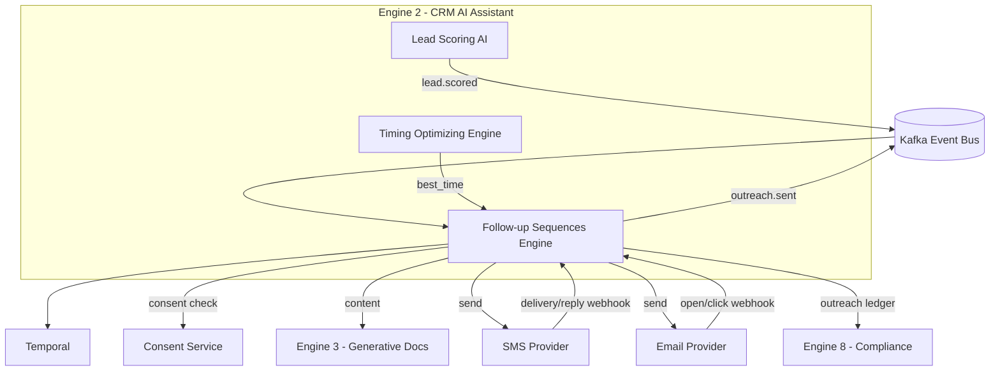
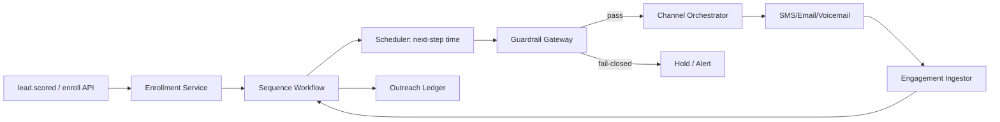
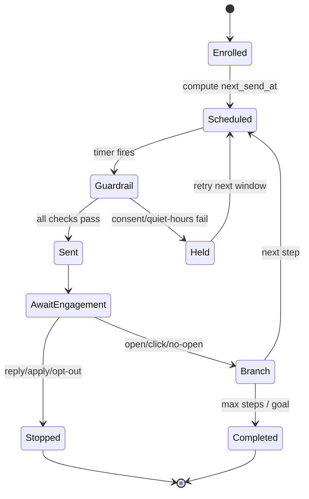
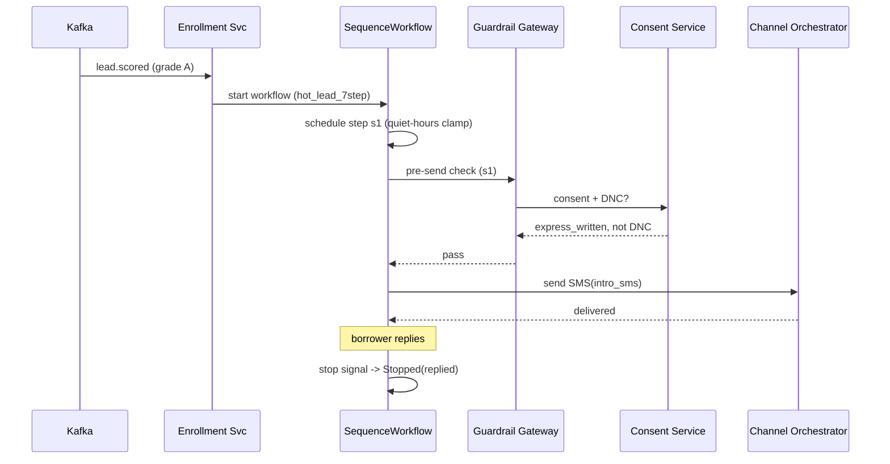

# Follow Up Sequence (Ticket Description for Refrence)

Overview
Manages automated, multi-step communication sequences (drip campaigns) across email, SMS, and WhatsApp — ensuring leads receive consistent, timely nurturing without any per-lead manual effort from agents. Hundreds of leads can be in different sequences simultaneously.
Goals
Nurture leads at scale without increasing agent workload
Reduce cold drop-off through consistent, scheduled touchpoints
Personalize communications at scale using lead data variables
Measure which sequences and messages perform best
Functional Requirements
Sequence builder: steps defined by channel, delay, message template, and conditions
Multi-channel support: email, SMS, WhatsApp
Enrollment triggers: stage change, manual enrollment, lead score threshold, tag applied
Personalization variables: {{lead_name}}, {{property_name}}, {{agent_name}}
Exit condition: if lead replies → pause sequence; if lead converts → exit sequence
Sequence branching: if email opened → Path A, if not opened → Path B
Opt-out/unsubscribe handling
Sequence analytics: delivery rate, open rate, reply rate per step
Technical Notes
Queue-based execution with retry logic on delivery failure
Channel integrations: email API, SMS gateway (Twilio), WhatsApp Business API
Enrollment state per lead: { lead_id, sequence_id, current_step, status, enrolled_at }
Rate limiting: prevent over-messaging a single lead
Acceptance Criteria
Sequences trigger correctly on all defined enrollment conditions
Messages send on correct schedule via correct channel
All personalization variables substitute correctly
Lead replying to any message pauses the active sequence
Opt-out is respected immediately and permanently
Analytics show delivery, open, and reply rates per step
Dependencies
Build Dependencies: None (standalone foundation engine — events from Task Automation and Stage Tracking can be mocked during development)
Runtime Data Integrations: Task Automation Engine (task trigger events), Stage Tracking Engine (stage-based enrollment triggers)
Feeds into: Engagement Pattern Analytics, Timing Optimizing Engine, Proactive Engagement Engine

# Follow-up Sequences Engine — Vision

## 1. Purpose & Mission
The **Follow-up Sequences Engine** is the cadence-orchestration sub-agent of Engine 2 (CRM AI Assistant). Its mission is to run **multi-step, multi-channel follow-up sequences** (drip cadences) for borrowers, brokers, and referral partners — with branching logic, channel selection, quiet-hours/consent enforcement, and intelligent stop conditions — so no qualified lead or in-flight deal goes cold, while every outreach respects TCPA/CAN-SPAM and borrower consent.

It answers: *"For this contact at this point in the lending journey, what is the next outreach step, on which channel, at what time — and when should we stop?"*

## 2. Problem Statement
Lead nurturing in lending is high-stakes and heavily regulated, yet usually ad hoc:
- LOs manually remember to follow up; busy weeks mean leads decay silently.
- Generic blast cadences ignore deal stage, score, and channel preference, hurting conversion and brand.
- Sequences don't **stop** when they should (borrower replied, applied, opted out, went DNC) — causing annoyance and TCPA exposure.
- Quiet hours, consent, and frequency caps are inconsistently enforced across SMS/email/call.
- There's no auditable record linking each outreach to its consent basis and cadence logic.

Result: missed conversions, compliance risk (TCPA penalties are per-message), and inconsistent borrower experience.

## 3. Target Users & Stakeholders
| Stakeholder | Use of the engine |
|-------------|-------------------|
| Loan Officers | Auto-enroll leads into the right cadence; get notified on replies |
| Marketing / Nurture | Design sequence templates, channels, and content variants |
| Sales Managers | Monitor cadence performance and conversion by step |
| Compliance (Engine 8) | Audit consent, quiet hours, DNC, frequency caps |
| Timing Optimizing Engine (peer) | Provides best-time-to-contact signals consumed here |
| Task Automation Engine (peer) | Emits events that enroll/advance contacts |
| Engine 3 (Generative Docs) | Generates personalized message content |

## 4. Value Proposition & Business Goals
- **Persistent, polite pursuit**: every qualified lead gets a structured, bran-aware cadence — no silent decay.
- **Channel intelligence**: SMS/email/call/voicemail chosen by preference, consent, and engagement.
- **Compliance by construction**: consent, TCPA quiet hours, DNC, and frequency caps enforced before any send.
- **Conversion lift**: branching on engagement (opened, clicked, replied) and deal stage maximizes response.
- **Auditable outreach**: each step ledgered with consent basis, channel, and stop reason.

## 5. Success Metrics & KPIs
| KPI | Target |
|-----|--------|
| Lead reply rate vs. manual baseline | +25% |
| Speed-to-first-touch after enrollment | p95 ≤ 5 min (subject to quiet hours) |
| Cadence completion without manual intervention | ≥ 90% |
| TCPA quiet-hours / DNC violations | 0 (hard guardrail) |
| Consent-verified sends | 100% |
| Over-contact rate (exceeds frequency cap) | 0 |
| Auto-stop accuracy on reply/apply/opt-out | ≥ 99% |
| Lead-to-application uplift (A/B vs. control) | +12% within 2 quarters |
| Unsubscribe/opt-out rate | ≤ 1.5% |

## 6. Scope
**In Scope**
- Sequence/template definition: steps, delays, channels, branches, exit conditions.
- Multi-channel send orchestration (SMS, email, call task, voicemail drop) via channel providers.
- Consent, TCPA quiet-hours, DNC, and frequency-cap enforcement.
- Branching on engagement signals and deal-stage changes; intelligent stop conditions.
- Enrollment via events/API; A/B testing of steps and content variants.
- Outreach ledger and per-step analytics.

**Out of Scope**
- Message *content generation* (delegated to Engine 3 / templates).
- Best-time prediction modeling (consumes Timing Optimizing Engine signals).
- Internal CRM task automation (Task Automation Engine).
- Final compliance adjudication (Engine 8); this engine enforces guardrails + emits signals.

## 7. Strategic Alignment
The Follow-up Sequences Engine is Engine 2's **engagement persistence layer**. It consumes `lead.scored`, `deal.stage_changed`, and Timing Optimizing signals to enroll and advance contacts through compliant cadences, and emits `outreach.sent`, `contact.replied`, and `sequence.completed` for forecasting, analytics, and compliance. By making nurture **systematic, channel-smart, and TCPA-safe**, it raises conversion while keeping CRequity.ai defensible under TCPA/CAN-SPAM, GDPR/CCPA consent, and SOC 2 — turning follow-up from a manual liability into a measurable, compliant growth engine.


# Follow-up Sequences Engine — Project Requirements

## 1. Overview
This document defines requirements for the Follow-up Sequences Engine, which orchestrates multi-step, multi-channel follow-up cadences for borrowers, brokers, and partners with branching logic, consent/TCPA enforcement, and intelligent stop conditions.

## 2. Objectives
- Enroll qualified leads/deals into the correct cadence automatically and advance them reliably.
- Enforce consent, TCPA quiet hours, DNC, and frequency caps on **every** send (zero violations).
- Branch sequences on engagement and deal-stage signals; stop precisely on reply/apply/opt-out.
- Provide marketers a versioned sequence designer with A/B testing.
- Emit an auditable outreach ledger linking each message to its consent basis.

## 3. Stakeholders & Roles
| Role | Responsibility |
|------|----------------|
| Product Owner (Nurture) | Owns cadence roadmap and KPIs |
| Marketing Ops | Designs sequences, channels, content variants |
| Backend Engineers | Build scheduler, branching engine, channel connectors |
| Compliance liaison (Engine 8) | Validates consent/TCPA enforcement |
| SRE | Owns send-path reliability and scheduler accuracy |
| Loan Officers | Receive reply notifications; can pause/override |

## 4. Functional Scope Summary
- Sequence definition (steps, delays, channels, branches, exits) with versioning.
- Enrollment (event/API), de-duplication, and per-contact single-active-sequence policy (configurable).
- Scheduler computing next-step time honoring quiet hours + best-time signals.
- Channel orchestration: SMS, email, voicemail drop, call-task; provider abstraction.
- Guardrails: consent check, DNC, quiet hours, frequency cap, suppression lists.
- Branching engine reacting to opens/clicks/replies/stage changes; stop-condition evaluation.
- A/B testing, analytics, and outreach ledger.

## 5. Non-Functional Requirements
| NFR | Target / Constraint |
|-----|---------------------|
| Scheduler accuracy | Step fires within ±60 s of computed time |
| Enrollment latency | p95 ≤ 5 s from trigger event |
| Send throughput | ≥ 2,000 messages/s across channels |
| Availability | 99.9% for send + guardrail path |
| Guardrail correctness | 100% pre-send consent/quiet-hours/DNC checks (fail-closed) |
| Idempotency | No duplicate sends per (contact, step, occurrence) |
| Consent freshness | DNC/opt-out propagation ≤ 60 s platform-wide |
| Security | PII + contact details encrypted; provider keys in vault |
| Compliance | TCPA, CAN-SPAM, GDPR/CCPA, SOC 2; 7-year ledger retention |
| Recoverability | RPO ≤ 1 min, RTO ≤ 15 min; scheduler state durable |

## 6. Constraints & Assumptions
- **Constraints**: Quiet hours enforced in the **contact's local timezone**; sends fail-closed if consent unknown; channel sends only via approved providers; LLM/content via Engine 3.
- **Assumptions**: Consent and DNC are mastered in the platform consent service; Timing Optimizing Engine publishes best-time windows; CRM provides contact timezone + channel preferences.

## 7. Dependencies
| Dependency | Type | Purpose |
|------------|------|---------|
| Consent Service | Platform | Source of truth for consent/DNC/opt-out |
| Kafka | Platform | Enrollment + engagement events |
| Temporal | Platform | Durable per-contact sequence execution |
| Channel Providers | External | SMS/email/voicemail delivery |
| Timing Optimizing Engine | Peer | Best-time-to-contact windows |
| Engine 3 (Generative Docs) | Cross-engine | Personalized message content |
| Engine 8 (Compliance) | Cross-engine | Audit + violation escalation |

## 8. Deliverables & Milestones
| Phase | Milestone | Deliverables |
|-------|-----------|--------------|
| P0 (Wk 1–3) | Foundations | Sequence schema, enrollment API, consent gateway |
| P1 (Wk 4–7) | Core cadence | Scheduler, email+SMS connectors, quiet-hours/DNC guardrails |
| P2 (Wk 8–11) | Branching | Engagement-driven branches, stop conditions, frequency caps |
| P3 (Wk 12–15) | Optimization | Timing-signal integration, A/B testing, analytics |
| P4 (Wk 16–18) | Hardening | Voicemail drop, load test 2k msg/s, SOC 2/TCPA evidence |
| GA | Launch | Sequence designer UI, runbooks, dashboards |

## 9. Risks & Mitigations
| Risk | Impact | Likelihood | Mitigation |
|------|--------|-----------|------------|
| TCPA quiet-hours violation | Critical (per-msg fines) | Low | Fail-closed timezone check; pre-send guardrail tests |
| Stale consent → message after opt-out | Critical | Low/Med | ≤60 s consent propagation; suppression on every send |
| Duplicate sends on replay | Medium | Medium | Idempotency keys per (contact, step, occurrence) |
| Over-contact across multiple sequences | Medium | Medium | Global frequency cap across all cadences |
| Scheduler drift at scale | Medium | Medium | Durable timers (Temporal) + accuracy monitoring |
| Channel provider outage | Medium | Medium | Multi-provider failover + retry + DLQ |

## 10. Acceptance Criteria
- A contact who replies, applies, or opts out has their active sequence stopped within ≤60 s and ledgered with the stop reason.
- No message is sent outside the contact's local 8am–9pm window or to a DNC contact (verified by guardrail tests).
- Enrollment from `lead.scored` produces a first compliant touch within p95 ≤ 5 min (subject to quiet hours).
- Replaying an enrollment event causes no duplicate sends.
- Global frequency cap prevents a contact from receiving more than the configured messages/day across all active sequences.


# Follow-up Sequences Engine — Functional Requirements

## 1. Overview
Specifies how the Follow-up Sequences Engine enrolls contacts, schedules and sends multi-channel steps, branches on engagement, enforces compliance guardrails, and stops cadences intelligently.

## 2. Actors
| Actor | Description |
|-------|-------------|
| Marketing Ops | Designs and versions sequence templates |
| Loan Officer | Enrolls contacts manually; receives reply alerts; can pause |
| Contact (Borrower/Broker) | Receives outreach; can reply or opt out |
| System (Event Bus) | Emits enrollment + engagement triggers |
| Consent Service | Provides consent/DNC/quiet-hour data |
| Compliance Reviewer | Audits outreach ledger |

## 3. Functional Requirements
| ID | Requirement | MoSCoW |
|----|-------------|--------|
| FR-001 | Define sequences with ordered steps, delays, channels, branches, exits | Must |
| FR-002 | Enroll a contact via event or REST API with de-duplication | Must |
| FR-003 | Compute next-step send time honoring quiet hours + best-time window | Must |
| FR-004 | Enforce consent + DNC + opt-out check fail-closed before every send | Must |
| FR-005 | Enforce global + per-sequence frequency caps across all cadences | Must |
| FR-006 | Send via SMS, email, voicemail-drop, or create call-task | Must |
| FR-007 | Branch on engagement signals (delivered/opened/clicked/replied) | Must |
| FR-008 | Branch on deal-stage change (e.g., stop nurture when application starts) | Must |
| FR-009 | Evaluate stop conditions (reply, apply, opt-out, max-steps, goal-met) | Must |
| FR-010 | Personalize message content via Engine 3 templates with variables | Should |
| FR-011 | Idempotent send per (contact_id, step_id, occurrence) | Must |
| FR-012 | A/B test step variants and report per-variant conversion | Should |
| FR-013 | Pause/resume/cancel an enrollment via API or UI | Must |
| FR-014 | Emit outreach + engagement events for analytics and compliance | Must |
| FR-015 | Maintain suppression lists (bounce, complaint, global DNC) | Must |
| FR-016 | Notify owner LO on inbound reply | Should |
| FR-017 | Support timezone-aware scheduling from contact profile | Must |
| FR-018 | Version sequences with safe migration of in-flight enrollments | Should |
| FR-019 | Throttle/retry on provider rate limits and failures | Must |
| FR-020 | Record consent basis + stop reason in the outreach ledger | Must |

## 4. User Stories
**US-1 — Compliant first touch**
> As a *loan officer*, when a new A-grade lead is scored, I want them auto-enrolled and contacted quickly, but never outside legal hours.
- **AC1**: On `lead.scored{grade: A}`, contact is enrolled in "hot_lead_7step".
- **AC2**: First SMS is scheduled for the next allowed window in the contact's timezone (8am–9pm), and consent is verified at send.
- **AC3**: If consent is missing/unknown, the step is held and an alert raised — no send.

**US-2 — Stop on reply/apply**
> As a *borrower*, when I reply or start my application, I should stop receiving cadence messages.
- **AC1**: On `contact.replied` or `deal.stage_changed{to: APPLICATION}`, the active sequence stops within ≤60 s.
- **AC2**: The stop reason is ledgered; LO is notified of the reply.

**US-3 — Branch on engagement**
> As a *marketer*, I want non-openers to get an SMS nudge while openers get a deeper email.
- **AC1**: If email step shows no open after 48h, branch to SMS step; if opened, branch to "value email 2".

## 5. Inputs & Outputs
**Inputs**: `lead.scored`, `deal.stage_changed`, `contact.replied`, engagement webhooks (delivered/opened/clicked/bounced), consent data, timezone/preferences, best-time windows.

**Outputs**: `outreach.sent`, `outreach.failed`, `contact.replied` (relay), `sequence.enrolled`, `sequence.completed`, `sequence.stopped`, ledger entries, owner notifications.

## 6. Business Rules
- **BR-1**: No send if consent is not affirmatively verified at send time (fail-closed).
- **BR-2**: Quiet hours = contact-local 9:00pm–8:00am; never send SMS/voice in this window.
- **BR-3**: Global frequency cap (default 2 messages/day, 5/week) spans all sequences.
- **BR-4**: A reply, application start, or opt-out is a terminal stop for all marketing cadences.
- **BR-5**: A contact may have at most one active marketing sequence (configurable per template class).
- **BR-6**: Manual LO outreach pauses automated steps for a cooldown window (default 24h).

## 7. Integration Points & APIs
**Consumed events**: `lead.scored`, `deal.stage_changed`, `contact.replied`, channel webhooks, `consent.updated`.
**Produced events**: `sequence.enrolled`, `outreach.sent`, `outreach.failed`, `sequence.stopped`, `sequence.completed`.
**REST**:
- `POST /sequences/v1/enrollments` — enroll a contact `{contact_id, sequence_id, context}`.
- `POST /sequences/v1/enrollments/{id}:pause|resume|cancel`.
- `GET /sequences/v1/enrollments/{id}` — state + step history.
- `POST /sequences/v1/sequences` — author/version a sequence.

## 8. Error Handling & Edge Cases
- **Unknown consent**: hold step, raise `consent.required`, never send.
- **Provider rate-limit/error**: backoff + retry; failover provider; DLQ after N attempts.
- **Timezone missing**: default to org HQ timezone + widen quiet hours conservatively.
- **Duplicate enrollment**: dedupe to single active enrollment; ledger "deduped."
- **Reply during scheduled gap**: cancel pending step before it fires (race-safe via Temporal signal).
- **Bounce/complaint**: add to suppression list; stop sequence; emit event.
- **Sequence version change mid-flight**: pin enrollment to its version unless safe-migrate flag set.


# Follow-up Sequences Engine — System Architecture

## 1. Architecture Overview & Principles
An event-driven service that runs durable, per-contact cadence state machines, enforces compliance guardrails before any send, and orchestrates multi-channel delivery. Principles:
- **Fail-closed compliance**: no send without verified consent + quiet-hours + DNC check.
- **Durable per-contact execution**: each enrollment is a long-running Temporal workflow with timers/signals.
- **Channel abstraction**: pluggable providers behind a uniform send interface with failover.
- **Stop-first design**: terminal signals (reply/apply/opt-out) preempt scheduled steps.

## 2. Context Diagram


## 3. Component Breakdown
| Component | Responsibility |
|-----------|----------------|
| Enrollment Service | Validates + de-dupes enrollments; starts workflow |
| Sequence Workflow (Temporal) | Per-contact durable state machine: steps, timers, branches |
| Scheduler | Computes next-step time from delays + quiet hours + best-time |
| Guardrail Gateway | Consent + DNC + quiet-hours + frequency-cap checks (fail-closed) |
| Channel Orchestrator | Uniform send interface; provider selection + failover |
| Engagement Ingestor | Consumes delivery/open/click/reply webhooks → branch signals |
| Stop Evaluator | Detects terminal conditions; preempts scheduled steps |
| Personalization Client | Calls Engine 3 for content rendering |
| Outreach Ledger | Append-only record of sends + consent basis + stop reasons |
| A/B Allocator | Assigns step/content variants; tracks outcomes |

## 4. Data Flow


## 5. Technology Stack
| Layer | Technology |
|-------|------------|
| Language/Runtime | Go (orchestrator/guardrails), Python (analytics/AB) |
| Messaging | Apache Kafka |
| Orchestration | Temporal (per-contact workflows + timers) |
| Datastores | Postgres (sequences, ledger), Redis (frequency cap, suppression cache) |
| Channels | SMS/email/voicemail providers via abstraction |
| Content | Engine 3 + template engine |
| API | REST via API gateway |
| Deploy | Kubernetes + HPA |
| Observability | OpenTelemetry, Prometheus, Grafana |

## 6. Integration & Messaging
- **Consumed**: `lead.scored`, `deal.stage_changed`, `contact.replied`, `consent.updated`, channel webhooks.
- **Produced**: `sequence.enrolled`, `outreach.sent`, `outreach.failed`, `sequence.stopped`, `sequence.completed`.
- **Workflow engine**: Temporal timers schedule steps; signals deliver replies/stage changes/opt-outs to preempt steps.
- **Kafka partitioning**: keyed by `contact_id` to maintain per-contact ordering and frequency accounting.

## 7. Data Stores & Feature Store
- **Postgres**: `sequence_def`, `enrollment`, `step_history`, `outreach_ledger`, `suppression_list`.
- **Redis**: frequency-cap counters (`freq:{contact_id}:day`), suppression/consent cache, scheduler locks.
- **Feature Store**: engagement features (open/click history, channel responsiveness) for branching.
- **S3**: ledger exports, A/B test reports.

## 8. Security & Compliance Boundaries
- Guardrail Gateway is the single choke point; sends physically cannot bypass it.
- Consent service is source of truth; cache TTL ≤60 s for fast opt-out propagation.
- PII and message bodies encrypted at rest/in transit; provider credentials in secret vault.
- Outreach ledger immutable, retained ≥7 years, streamed to Engine 8 for TCPA/CAN-SPAM audit.
- Quiet hours computed in contact-local timezone; conservative fallback when unknown.

## 9. Scalability & Deployment
- Temporal workers scale horizontally; millions of concurrent enrollments as durable workflows.
- Channel orchestrator autoscaled on send-queue depth; provider rate-limit aware throttling.
- Multi-AZ; Postgres HA; Redis cluster; multi-provider failover for channels.
- Sequence versioning pins in-flight enrollments to avoid disruptive migrations.

## 10. Observability
- Metrics: send latency, scheduler accuracy (±60 s), guardrail block counts, reply rate, opt-out rate.
- Compliance dashboards: zero quiet-hours/DNC violations (alert on any non-zero), consent-verified %.
- Tracing across enroll → schedule → guardrail → send → webhook.
- Alerts: provider failover events, frequency-cap breaches (should be 0), DLQ growth, consent cache staleness.


# Follow-up Sequences Engine — System Design

## 1. Detailed Component Design
**Enrollment Service** — Validates `{contact_id, sequence_id, context}`, checks single-active-sequence policy, and starts a Temporal `SequenceWorkflow` keyed by `enrollment_id`. Rejects duplicates idempotently.

**SequenceWorkflow (Temporal)** — Holds per-contact state: current step index, branch path, variant assignment. Uses durable timers for delays and waits on signals (`reply`, `stage_changed`, `opt_out`, `engagement`). On each step it calls the Guardrail Gateway, then the Channel Orchestrator.

**Guardrail Gateway** — Synchronous fail-closed check: consent verified? not on DNC/suppression? within quiet hours (contact tz)? under frequency cap? All must pass or the step holds.

**Scheduler** — `next_send_at = max(now + step.delay, next_quiet_hours_window, best_time_window)`. Best-time window comes from Timing Optimizing Engine; clamped to legal hours.

**Stop Evaluator** — Maps terminal signals to stop reasons and completes the workflow, releasing pending timers.

## 2. Data Models & Schemas
```sql
CREATE TABLE sequence_def (
  sequence_id  UUID PRIMARY KEY,
  name         TEXT NOT NULL,
  version      INT  NOT NULL,
  steps        JSONB NOT NULL,   -- ordered steps w/ channel, delay, branches
  stop_rules   JSONB NOT NULL,   -- terminal conditions
  status       TEXT NOT NULL,    -- draft|active|archived
  UNIQUE (name, version)
);

CREATE TABLE enrollment (
  enrollment_id UUID PRIMARY KEY,
  contact_id    UUID NOT NULL,
  sequence_id   UUID NOT NULL,
  version       INT NOT NULL,
  state         TEXT NOT NULL,   -- active|paused|stopped|completed
  current_step  INT  NOT NULL DEFAULT 0,
  variant       TEXT,
  enrolled_at   TIMESTAMPTZ DEFAULT now(),
  stopped_reason TEXT
);

CREATE TABLE outreach_ledger (
  id            BIGSERIAL PRIMARY KEY,
  enrollment_id UUID NOT NULL,
  contact_id    UUID NOT NULL,
  step_id       TEXT NOT NULL,
  channel       TEXT NOT NULL,   -- sms|email|voicemail|call_task
  consent_basis TEXT NOT NULL,   -- express_written|prior_business|...
  status        TEXT NOT NULL,   -- sent|failed|held|blocked
  occurrence    INT NOT NULL,
  sent_at       TIMESTAMPTZ DEFAULT now(),
  UNIQUE (enrollment_id, step_id, occurrence)
);
```

Sequence definition (JSON):
```json
{
  "name": "hot_lead_7step",
  "version": 2,
  "steps": [
    {"id": "s1", "channel": "sms", "delay": "PT0M",
     "template": "intro_sms", "branches": [
        {"if": "no_reply_after:PT48H", "goto": "s2"}]},
    {"id": "s2", "channel": "email", "delay": "PT48H",
     "template": "value_email_1", "branches": [
        {"if": "opened", "goto": "s3"}, {"if": "no_open_after:PT48H", "goto": "s4"}]},
    {"id": "s3", "channel": "email", "delay": "PT72H", "template": "value_email_2"},
    {"id": "s4", "channel": "sms", "delay": "PT24H", "template": "nudge_sms"}
  ],
  "stop_rules": ["replied", "deal.stage>=APPLICATION", "opt_out", "max_steps:7"]
}
```

## 3. API Specification
**Enroll**
```
POST /sequences/v1/enrollments
{ "contact_id": "c-42", "sequence_id": "hot_lead_7step", "context": {"deal_id": "d-9", "grade": "A"} }
```
```json
{ "enrollment_id": "e-1001", "state": "active", "next_step_at": "2026-06-15T20:00:00Z" }
```

**Get enrollment**
```
GET /sequences/v1/enrollments/e-1001
```
```json
{
  "enrollment_id": "e-1001", "contact_id": "c-42", "state": "active", "current_step": 1,
  "history": [
    {"step_id": "s1", "channel": "sms", "status": "sent", "sent_at": "2026-06-15T20:00:05Z"}
  ]
}
```

## 4. Workflow / Algorithm Design


Next-step scheduling algorithm (pseudo): clamp `now + delay` forward to the next contact-local allowed window, then snap toward the best-time window if it falls within legal hours; verify frequency budget remaining before committing.

## 5. Sequence Diagram


## 6. Database / Storage Schema
- **Postgres**: `sequence_def`, `enrollment`, `step_history`, `outreach_ledger`, `suppression_list(contact_id, reason, added_at)`.
- **Redis**: `freq:{contact_id}:day` / `:week` counters, consent cache (TTL ≤60 s), scheduler dedupe locks.
- **S3**: A/B reports, ledger compliance exports.

## 7. Configuration & Parameters
| Parameter | Default | Purpose |
|-----------|---------|---------|
| `quiet_hours` | 21:00–08:00 local | TCPA quiet hours |
| `freq_cap_day` | 2 | Max messages/day across cadences |
| `freq_cap_week` | 5 | Max messages/week |
| `consent_cache_ttl_s` | 60 | Opt-out propagation bound |
| `manual_outreach_cooldown_h` | 24 | Pause automation after LO touch |
| `provider_retry_max` | 4 | Channel retry attempts |

## 8. Testing Strategy
- **Guardrail tests**: assert zero sends outside quiet hours / to DNC across fuzzed timezones.
- **Workflow tests**: Temporal test env for timers, branch signals, stop preemption races.
- **Idempotency**: replay enrollment + webhooks → no duplicate sends.
- **Consent propagation**: opt-out reflected ≤60 s; in-flight step blocked.
- **A/B correctness**: variant allocation balanced; outcome attribution accurate.
- **Load**: 2k msgs/s with provider failover injected.

## 9. Performance & Reliability Considerations
- Durable timers ensure steps fire even across restarts; scheduler accuracy monitored to ±60 s.
- Stop signals preempt pending steps race-safely (workflow signal before timer).
- Multi-provider failover and backoff protect deliverability; DLQ for terminal failures.
- Frequency caps in Redis with atomic increments prevent over-contact under concurrency.
- Consent cache short TTL trades minor latency for fast, safe opt-out enforcement.
