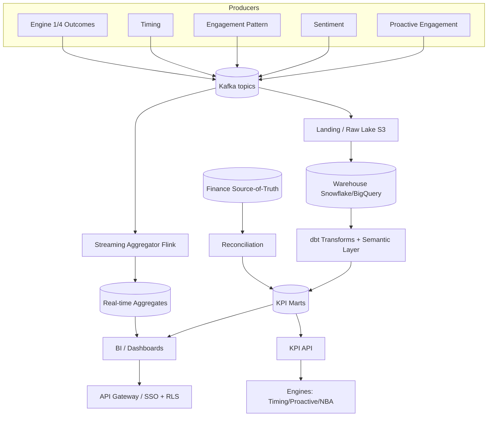
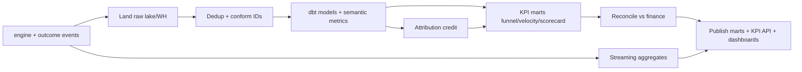
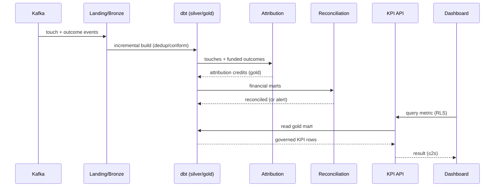

# Performance Analytics System (Ticket Descriptions for Reference)

Description

Overview
A centralized analytics and reporting system that measures the performance of agents, campaigns, and the entire sales pipeline in real time — replacing manual spreadsheets with always-on dashboards and automated reports. Gives managers the data needed to coach agents, identify bottlenecks, and make strategic decisions.
Goals
Give managers real-time visibility of team and individual agent performance
Surface pipeline bottlenecks (where deals slow down or die)
Track communication quality and follow-up compliance
Replace end-of-month manual reporting with live, automated dashboards
Functional Requirements
Agent KPIs: leads assigned, contacted rate, response time, conversion rate, tasks completed, deals closed
Pipeline KPIs: stage-wise conversion rates, average time in stage, drop-off rates per stage
Revenue KPIs: bookings, deal value, projected revenue
Communication KPIs: messages sent, sequence open/reply rates, follow-up compliance
Role-based access: agent sees own stats, manager sees all
Date range filters: daily, weekly, monthly, custom
Agent leaderboard view
Pipeline funnel visualization
Export: CSV and PDF for all reports
Automated weekly email reports to managers
Technical Notes
Separate analytics DB (read-optimized) synced from transactional CRM DB
KPI aggregations pre-computed and refreshed every 15 minutes
PDF reports rendered server-side and emailed on schedule
Acceptance Criteria
Agent dashboard shows all personal KPIs updated in near real-time
Manager dashboard shows individual and team-wide performance
Pipeline funnel shows conversion rates and drop-off per stage
All charts support date range filtering
Reports export correctly as CSV and PDF
Automated weekly reports are emailed to managers on schedule
Dependencies
Depends on: Stage Tracking Engine, Lead Assignment Engine, Follow-up Sequences Engine, Task Automation Engine
Feeds into: Forecasting AI Engine, Feedback Loop System

Subtasks

CEAAPSS-562
ROI Attribution
CEAAPSS-563
Channel Effectiveness
CEAAPSS-646
Vision
CEAAPSS-647
Project Requirements
CEAAPSS-648
Functional Requirement
CEAAPSS-649
System Architecture
CEAAPSS-650
System Design

ROI Attribution


Description

Overview
Tracks and attributes revenue outcomes and conversions back to the specific campaigns, AI engine recommendations, communication sequences, or agent actions that drove them. Answers the question: "Which activities are actually generating bookings and revenue?"
Goals
Identify which campaigns, channels, and AI actions generate the most ROI
Eliminate spend on low-performing activities with evidence
Give management a clear picture of what's driving revenue
Enable data-driven budget allocation for campaigns and tools
Functional Requirements
Attribution model support: First Touch (which activity first engaged the lead), Last Touch (which activity immediately preceded conversion), Multi-Touch (weighted credit across all touchpoints), and Time Decay (more credit to recent touchpoints)
Attribution per entity: campaign, sequence, AI recommendation type, agent, channel, property type
Revenue attributed per touchpoint over configurable time window
ROI calculation per campaign: (revenue attributed - campaign cost) / campaign cost × 100
Attribution dashboard: ranked view of campaigns/channels/actions by attributed revenue
Comparison view: attribution model toggle (switch between First Touch, Last Touch, Multi-Touch)
Export: attributed revenue report per campaign/period as CSV or PDF
Time range filter: daily, weekly, monthly, quarterly
Technical Notes
Conversion event: booking confirmed or deal closed (configurable)
Attribution window: configurable lookback period (default: 90 days before conversion)
Touchpoint log: every significant lead interaction stored with timestamp and source
Multi-touch credit: linear distribution across all touchpoints within attribution window, or time-decay weighted
Data model: { lead_id, conversion_value, touchpoints: [{ source, timestamp, channel }] }
Acceptance Criteria
Attribution model is selectable (First Touch, Last Touch, Multi-Touch, Time Decay)
All significant lead touchpoints are logged with source, channel, and timestamp
Revenue is correctly attributed across campaigns, sequences, channels, and agent actions
ROI is calculated per campaign with cost input field
Attribution dashboard shows entities ranked by attributed revenue
Reports exportable as CSV and PDF with date range filter
Switching attribution model recalculates and updates dashboard in real time
Dependencies
Depends on: CEAAPSS-561 Performance Analytics System (conversion and activity data), Stage Tracking Engine (conversion events), Follow-up Sequences Engine (touchpoint data)
Feeds into: Market Opportunity Alerts Engine, Personalized Offers Engine (informs which offer types drive best ROI)

Channel Effectiveness


Description

Overview
Analyzes the performance of each communication channel — email, SMS, WhatsApp, and call — across key metrics like delivery rate, open rate, response rate, and conversion contribution. Identifies which channels work best for which lead segments and at which pipeline stages, informing smarter channel selection across the CRM.
Goals
Identify which channels drive the highest engagement and conversion per lead segment
Reduce spend and effort on underperforming channels
Feed data-driven channel selection into the Timing Optimizing Engine
Help managers make informed decisions about channel investment and strategy
Functional Requirements
Per-channel metrics: delivery rate, open rate, click rate, reply rate, opt-out rate, conversion contribution rate
Segmented analysis: channel performance broken down by lead segment (score tier, stage, property type, area)
Stage-level channel analysis: which channel works best at each pipeline stage (e.g., WhatsApp at Interested, email at Negotiation)
Time-of-day performance: engagement rates by hour and day per channel
Channel comparison view: side-by-side metric comparison across all channels
Trend over time: channel performance trend charts (weekly/monthly)
Recommendations surfaced: "WhatsApp outperforms email by 34% for leads in Negotiation stage"
Export: channel effectiveness report as CSV or PDF
Technical Notes
Input: all message delivery and engagement events from Follow-up Sequences Engine and Personalized Alerts Engine
Segmentation join: enrich each event with lead's current score, stage, area, and property type
Aggregation: compute metrics per channel × segment × stage combination
Insight generation: flag channel-segment combinations where performance diverges significantly from average
Acceptance Criteria
All 4 channels (email, SMS, WhatsApp, call) have visible performance metrics
Metrics can be filtered by lead segment, pipeline stage, and date range
Stage-level channel breakdown shows which channel performs best at each stage
Time-of-day engagement heatmap is available per channel
Channel comparison view shows all channels side-by-side
Performance insights/recommendations surface automatically
Report exports correctly as CSV and PDF
Dependencies
Depends on: CEAAPSS-561 Performance Analytics System, Follow-up Sequences Engine (message event data), Engagement Pattern Analytics Engine
Feeds into: Timing Optimizing Engine (channel preference data), Personalized Alerts Engine (channel selection logic)

# Performance Analytics System — Vision

> Sub-agent of **Engine 2 — CRM AI Assistant**, CRequity.ai

## 1. Purpose & Mission

The Performance Analytics System (PAS) is the **measurement and accountability layer** of the CRM AI
Assistant. Its mission is to **quantify how well people and engines are performing** — loan officers,
brokers, teams, campaigns, and every Engine 2 sub-agent — through trustworthy KPIs, dashboards, and
multi-touch attribution that connect actions to funded-loan outcomes.

PAS is the system of record for "is it working?" It answers questions like: *Which LOs convert
best?*, *Did the Proactive Engagement Engine actually lift reactivation?*, *What is the ROI of
send-time optimization?*, *Which channel + sequence drives funded loans per dollar?*

## 2. Problem Statement

Without rigorous measurement, an AI-native CRM flies blind:

- Rep and team performance is judged on vanity metrics (activity counts), not outcomes.
- The contribution of each AI engine (sentiment, timing, proactive) to revenue is unknown.
- Attribution is single-touch or last-click, undercrediting nurturing and AI-driven touches.
- Dashboards are stale, inconsistent across teams, and not governed (different "conversion" defs).
- Leadership lacks reliable cohort, funnel, and pipeline-velocity analytics to steer the business.

## 3. Target Users & Stakeholders

| Stakeholder | How they use PAS |
|-------------|------------------|
| Sales Managers / Directors | Rep + team scorecards, pipeline velocity, coaching insights |
| Loan Officers / Brokers | Personal dashboards: conversion, response, cycle time |
| Engine 2 Product/ML teams | Engine-level KPIs, A/B lift, model impact on revenue |
| Executives | Funnel, cohort, forecast-attainment, ROI dashboards |
| Marketing | Campaign + channel + sequence attribution |
| Compliance/Finance | Auditable, governed metric definitions for reporting |

## 4. Value Proposition & Business Goals

- **Outcome-based performance management** for reps and teams (funded loans, not just calls).
- **Prove engine ROI** via attribution + A/B lift so investment targets what works.
- **One governed metric layer** — consistent KPI definitions across all dashboards.
- **Faster decisions** with near-real-time, drillable analytics.

Business goals: improve funded-loan conversion, increase rep productivity, optimize spend across
channels/engines, and provide trustworthy reporting for leadership and audit.

## 5. Success Metrics & KPIs

| Metric (of PAS itself) | Target |
|------------------------|--------|
| Dashboard query latency (p95, pre-aggregated) | ≤ 2 s |
| Data freshness (event → dashboard) | ≤ 5 min streaming, ≤ 1 h batch |
| Metric-definition governance coverage | 100% of published KPIs |
| Attribution model coverage of touches | ≥ 95% of outbound touches |
| Reconciliation accuracy vs source-of-truth (funded loans) | ≥ 99.5% |
| Self-serve report adoption (MAU of dashboards) | grow QoQ |
| Time-to-new-metric (definition → live) | ≤ 2 days |

**KPIs PAS computes** (examples): lead→app conversion, app→fund conversion, cycle time per stage,
response rate, EHS-to-conversion lift, engine A/B uplift, cost-per-funded-loan, pipeline velocity,
forecast attainment, rep ranking, channel ROI, sequence completion rate.

## 6. Scope

**In scope**
- Ingest events from all Engine 2 sub-agents + CRM/loan outcomes (Engines 1/4).
- Governed semantic/metric layer (single KPI definitions, versioned).
- Multi-touch attribution (rule-based + data-driven) for touches → funded loans.
- Dashboards, scorecards, cohort/funnel/velocity analytics, scheduled reports + alerts.
- Self-serve exploration and KPI API for other engines/UIs.

**Out of scope**
- Producing the underlying signals (owned by each sub-agent; PAS consumes them).
- Real-time operational decisions (PAS measures; engines act).
- Financial system-of-record (PAS reconciles to it, doesn't replace it).
- Model training for other engines (PAS supplies labels/metrics, not their models).

## 7. Strategic Alignment

PAS is the **feedback and accountability hub** for Engine 2 and the broader platform. It closes the
loop: sub-agents act, PAS measures impact, and those measurements (A/B lift, attribution, labels)
feed back to improve every model — Lead Scoring, Timing, Proactive Engagement, and more. By
providing one governed, trustworthy analytics layer, PAS lets CRequity.ai run the CRM as a
measurable, continuously-improving, ROI-driven system.

# Performance Analytics System — Project Requirements

> Sub-agent of **Engine 2 — CRM AI Assistant**, CRequity.ai

## 1. Overview

Delivery requirements for the Performance Analytics System (PAS): an analytics + reporting subsystem
providing a governed metric layer, multi-touch attribution, dashboards, and a KPI API measuring CRM
rep, team, campaign, and engine performance.

## 2. Objectives

1. Build a governed semantic/metric layer with single, versioned KPI definitions.
2. Ingest events from all Engine 2 sub-agents + loan outcomes; reconcile to source-of-truth ≥99.5%.
3. Implement rule-based + data-driven multi-touch attribution covering ≥95% of touches.
4. Deliver fast (≤2s p95) drillable dashboards + scorecards with ≤5-min streaming freshness.
5. Provide a KPI API + self-serve exploration for engines, UIs, and leadership.

## 3. Stakeholders & Roles

| Role | Responsibility |
|------|----------------|
| Product Owner (Engine 2) | KPI taxonomy + governance ownership |
| Analytics Engineering | Semantic layer, transforms (dbt), attribution models |
| Data Engineering | Ingestion pipelines, warehouse, streaming aggregates |
| BI/Visualization | Dashboards, scorecards, self-serve |
| Sales Leadership | Requirements for scorecards + funnel analytics |
| Finance/Compliance | Metric governance, reconciliation, audit |

## 4. Functional Scope Summary

Ingest engine + outcome events → model in warehouse (governed metrics) → compute attribution +
KPIs → serve dashboards, KPI API, scheduled reports + alerts. Detail in `03_Functional_Requirements.md`.

## 5. Non-Functional Requirements

| ID | Category | Requirement | Target |
|----|----------|-------------|--------|
| NFR-01 | Latency | Dashboard query (pre-aggregated, p95) | ≤ 2 s |
| NFR-02 | Freshness | Streaming metric freshness | ≤ 5 min |
| NFR-03 | Freshness | Batch/warehouse model refresh | ≤ 1 h |
| NFR-04 | Accuracy | Reconciliation vs funded-loan source-of-truth | ≥ 99.5% |
| NFR-05 | Governance | Published KPIs with versioned definitions | 100% |
| NFR-06 | Availability | Dashboard + KPI API uptime | ≥ 99.9% |
| NFR-07 | Scalability | Warehouse concurrency | ≥ 200 concurrent queries |
| NFR-08 | Security | Row-level security by team/role/tenant | Enforced |
| NFR-09 | Auditability | Metric lineage + definition history | Full lineage |
| NFR-10 | Attribution | Touch coverage | ≥ 95% |
| NFR-11 | Recovery | RPO / RTO | RPO ≤ 15 min, RTO ≤ 1 h |

## 6. Constraints & Assumptions

- **Constraints**: PII minimized in analytics layer (aggregates + pseudonymized IDs); row-level
  security by role/team/tenant; financial figures must reconcile to Engine 4/finance source-of-truth;
  metric changes require governance approval + versioning.
- **Assumptions**: Sub-agents emit standardized outcome/touch events with shared IDs (contact_id,
  deal_id, touch_id, tracking_id); funded-loan outcomes available from Engine 4/loan system.

## 7. Dependencies

- All Engine 2 sub-agents (touch, outcome, score events).
- Engine 1 (Underwriting) + Engine 4 (Loan & Credit) for funnel/funded outcomes.
- Warehouse (Snowflake/BigQuery), dbt (transforms), BI tool (e.g., Looker/Superset).
- Kafka + streaming aggregation (Flink/Spark) for near-real-time metrics.
- Identity/consent for pseudonymization; SSO for dashboard access control.

## 8. Deliverables & Milestones

| Phase | Deliverable | Exit criteria |
|-------|-------------|---------------|
| P0 (Wks 1–3) | Event ingestion + warehouse landing + core data model | events landing, dedup correct |
| P1 (Wks 4–6) | Governed semantic/metric layer (dbt) + lineage | KPIs versioned, lineage visible |
| P2 (Wks 7–9) | Funnel/cohort/velocity marts + reconciliation | reconcile ≥99.5% |
| P3 (Wks 10–12) | Attribution (rule-based + data-driven) | coverage ≥95% |
| P4 (Wks 13–15) | Dashboards, scorecards, KPI API, RLS | p95 ≤2s, RLS enforced |
| P5 (Wks 16–17) | Streaming aggregates, alerts, GA | freshness ≤5min, sign-off |

## 9. Risks & Mitigations

| ID | Risk | Likelihood | Impact | Mitigation |
|----|------|-----------|--------|------------|
| R-01 | Inconsistent metric definitions ("which conversion?") | High | High | Governed semantic layer, single source, versioning |
| R-02 | Attribution disputes / credibility | Med | High | Transparent models, multiple views, documentation |
| R-03 | Reconciliation drift vs finance | Med | High | Automated reconciliation checks + alerts |
| R-04 | PII exposure in analytics | Low | Critical | Pseudonymization, RLS, aggregate-only views |
| R-05 | Dashboard performance degradation | Med | Med | Pre-aggregation, caching, query governance |
| R-06 | Vanity-metric misuse for ranking | Med | Med | Outcome-weighted scorecards, guardrail metrics |

## 10. Acceptance Criteria

- All published KPIs governed + versioned with lineage (100%).
- Reconciliation vs funded-loan source-of-truth ≥99.5% with automated checks.
- Attribution covers ≥95% of touches; methodology documented and reproducible.
- Dashboards p95 ≤2s; streaming freshness ≤5 min; RLS enforced by role/team/tenant.
- KPI API serving ≥1 downstream consumer (e.g., Timing/Proactive feedback) in UAT.
- Finance + compliance sign-off on metric governance before GA.

# Performance Analytics System — Functional Requirements

> Sub-agent of **Engine 2 — CRM AI Assistant**, CRequity.ai

## 1. Overview

Functional requirements, user stories, I/O contracts, business rules, integrations, and edge cases
for the Performance Analytics System (PAS).

## 2. Actors

| Actor | Description |
|-------|-------------|
| Event Producers | All Engine 2 sub-agents (touch/outcome/score events) |
| Outcome Source | Engine 1/4 (applications, fundings) |
| Sales Manager | Views scorecards, pipeline velocity |
| Loan Officer | Views personal dashboard |
| Executive | Views funnel, cohort, forecast-attainment |
| Analytics Engineer | Defines metrics, attribution, transforms |
| KPI API Consumers | Engines using metrics as feedback (Timing, Proactive, NBA) |

## 3. Functional Requirements

| FR ID | Requirement | MoSCoW |
|-------|-------------|--------|
| FR-001 | Ingest standardized events from all sub-agents + loan outcomes | Must |
| FR-002 | Deduplicate + conform events into a unified activity/outcome model | Must |
| FR-003 | Maintain a governed semantic layer of versioned KPI definitions | Must |
| FR-004 | Compute funnel conversion metrics (lead→app→fund) by stage | Must |
| FR-005 | Compute pipeline velocity + cycle time per stage and per rep | Must |
| FR-006 | Compute rep + team scorecards (outcome-weighted) | Must |
| FR-007 | Compute engine-level KPIs + A/B uplift (e.g., timing/proactive impact) | Must |
| FR-008 | Run multi-touch attribution (rule-based + data-driven) | Must |
| FR-009 | Compute channel + campaign + sequence ROI (cost-per-funded-loan) | Should |
| FR-010 | Provide drillable dashboards with role-based row-level security | Must |
| FR-011 | Provide KPI API for programmatic metric retrieval | Must |
| FR-012 | Reconcile financial metrics to source-of-truth + alert on drift | Must |
| FR-013 | Support cohort analysis (e.g., by acquisition month, segment) | Should |
| FR-014 | Schedule reports + threshold alerts (e.g., conversion drop) | Should |
| FR-015 | Provide self-serve exploration with governed fields | Should |
| FR-016 | Expose metric lineage + definition history | Must |
| FR-017 | Compute forecast-attainment vs Forecasting Engine targets | Should |
| FR-018 | Provide near-real-time streaming KPIs for ops dashboards | Should |

## 4. User Stories

**US-1 (Manager scorecard):** *As a sales manager, I want outcome-based rep scorecards so I coach on
funded loans, not call volume.*
- AC: Scorecard shows conversion, cycle time, response rate, funded $, ranked with guardrail metrics;
  RLS limits to manager's team.

**US-2 (Engine ROI):** *As Engine 2 product, I want to see the funded-loan lift from the Proactive
Engagement Engine vs holdout.*
- AC: A/B dashboard shows treatment vs control conversion + confidence interval, attributed via tracking IDs.

**US-3 (Funnel):** *As an executive, I want the lead→app→fund funnel with cycle times so I can find
bottlenecks.*
- AC: Funnel viz with stage conversion + median cycle time, drillable by team/segment/period.

**US-4 (Attribution):** *As marketing, I want multi-touch credit so nurturing touches aren't ignored.*
- AC: Attribution report shows credit per touch/channel under selectable model (first/last/linear/data-driven).

**US-5 (Governed metric):** *As an analytics engineer, I want one definition of "conversion" used
everywhere.*
- AC: Metric defined once in semantic layer, versioned, with lineage; all dashboards reference it.

## 5. Inputs & Outputs

**Inputs**
- Events: `engagement.touch.dispatched.v1`, `engagement.outcome.v1`, `sentiment.scored.v1`,
  `engagement.scored.v1`, `timing.recommendation.v1`, `nba.recommendation.v1`.
- Outcomes: `loan.application.created.v1`, `loan.funded.v1`, `deal.updated.v1` (from Engines 1/4).
- Cost data: channel/campaign spend (finance feeds).

**Outputs**
- Governed KPI marts + dashboards; KPI API responses; attribution tables; scheduled reports/alerts;
  `analytics.kpi.snapshot.v1` events for downstream feedback.

## 6. Business Rules

- BR-1: A KPI may only be published if it exists in the governed semantic layer with a version.
- BR-2: "Funded loan" + revenue figures must reconcile to Engine 4/finance source-of-truth.
- BR-3: Attribution windows are configurable (default 90-day lookback for funded loans).
- BR-4: Scorecards must include guardrail metrics (quality/compliance), not just volume.
- BR-5: Row-level security restricts data to the viewer's team/role/tenant.
- BR-6: Analytics layer stores pseudonymized IDs; raw PII excluded.
- BR-7: Late-arriving outcomes trigger recomputation of affected attribution/cohorts.

## 7. Integration Points & APIs

**Consumes (Kafka):** all touch/outcome/score topics + `loan.funded.v1`, `loan.application.created.v1`.
**Produces (Kafka):** `analytics.kpi.snapshot.v1`, `analytics.alert.v1`.
**REST (via gateway):**
- `GET /v1/kpi/{metric}?dim=&filter=&period=` — governed metric retrieval.
- `GET /v1/attribution?deal_id=` — touch-level credit for a funded deal.
- `GET /v1/scorecards/reps/{repId}` — rep scorecard.
- `GET /v1/funnel?team=&period=` — funnel + velocity.
- `POST /v1/reports/schedule` — schedule a report/alert.

## 8. Error Handling & Edge Cases

- Duplicate events (at-least-once) → idempotent dedupe on event_id.
- Late-arriving funded outcome (after attribution window) → reprocess + version the snapshot.
- Missing tracking_id on a touch → attributed via heuristic fallback; flagged `low_confidence`.
- Reconciliation mismatch > threshold → block KPI publish + raise `analytics.alert.v1`.
- Metric definition change → new version; old dashboards pinned until migrated.
- Sparse cohort (small n) → suppress/flag to avoid misleading rates.
- Cross-tenant query attempt → denied by RLS; audit logged.

# Performance Analytics System — System Architecture

> Sub-agent of **Engine 2 — CRM AI Assistant**, CRequity.ai

## 1. Architecture Overview & Principles

PAS is a **lakehouse + streaming analytics subsystem** with a governed semantic layer. Principles:

- **Single source of metric truth**: every KPI defined once in a versioned semantic layer.
- **ELT, not ETL**: land raw events, transform in-warehouse (dbt) for lineage + reproducibility.
- **Dual-speed**: streaming aggregates for ops freshness; batch marts for governed accuracy.
- **Reconcilable**: financial metrics tie out to Engine 4/finance source-of-truth.
- **Secure by default**: pseudonymized IDs, row-level security, audited access.

## 2. Context Diagram



## 3. Component Breakdown

| Component | Responsibility |
|-----------|----------------|
| Ingestion / Landing | Consume Kafka, land raw events to lake + warehouse |
| Streaming Aggregator | Near-real-time KPI windows (Flink/Spark) |
| Conform/Dedup | Idempotent dedupe + ID conforming |
| Semantic Layer (dbt) | Versioned metric definitions + lineage |
| KPI Marts | Funnel, velocity, scorecards, cohort, channel ROI |
| Attribution Engine | Rule-based + data-driven multi-touch credit |
| Reconciliation | Tie financial metrics to source-of-truth; alert drift |
| KPI API | Governed metric retrieval for engines/UIs |
| BI / Dashboards | Drillable viz with RLS |
| Alerting / Scheduler | Threshold alerts + scheduled reports |

## 4. Data Flow



## 5. Technology Stack

| Layer | Technology |
|-------|-----------|
| Messaging | Apache Kafka |
| Lake / Storage | S3 (raw, Parquet/Iceberg) |
| Warehouse | Snowflake / BigQuery |
| Transforms / Semantic | dbt (models, metrics, tests, lineage) |
| Streaming | Apache Flink / Spark Structured Streaming |
| Attribution | Python (Shapley/Markov data-driven), SQL rule-based |
| BI | Looker / Superset / Metabase |
| API | FastAPI KPI service behind gateway |
| Access | SSO (OIDC), row-level security policies |
| Orchestration | Airflow / Argo (dbt runs, recompute) |
| Observability | OpenTelemetry, Prometheus, Grafana, dbt test results |

## 6. Integration & Messaging

| Topic | Direction | Notes |
|-------|-----------|-------|
| `engagement.touch.dispatched.v1` | in | outbound touches |
| `engagement.outcome.v1` | in | engagement outcomes |
| `timing.recommendation.v1` | in | timing decisions for attribution |
| `loan.application.created.v1` | in | funnel app stage |
| `loan.funded.v1` | in | funded outcome (source-of-truth join) |
| `analytics.kpi.snapshot.v1` | out | periodic KPI snapshots |
| `analytics.alert.v1` | out | threshold/anomaly alerts |

## 7. Data Stores & Semantic Layer

- **Raw lake (S3/Iceberg)**: immutable event landing for replay + audit.
- **Warehouse**: staging → conformed → marts (medallion pattern).
- **Semantic layer (dbt metrics)**: versioned KPI definitions, the single source of metric truth.
- **Serving cache**: pre-aggregated marts + BI extract cache for ≤2s queries.
- **Reconciliation store**: comparison tables vs finance source-of-truth.

## 8. Security & Compliance Boundaries

- Analytics layer stores pseudonymized IDs; raw PII excluded (BR-6).
- Row-level security by team/role/tenant enforced at warehouse + BI.
- Metric governance: changes require approval + versioning; full lineage retained.
- Access audited; cross-tenant queries denied.

## 9. Scalability & Deployment

- Warehouse auto-scales compute (virtual warehouses/slots) for concurrency ≥200.
- dbt runs orchestrated incrementally; large marts partitioned/clustered by date + team.
- Streaming aggregator scaled by Kafka partitions; backfill via batch reprocess.
- Late-data handling triggers targeted recompute of affected partitions.

## 10. Observability

- Metrics: ingestion lag, dbt run duration + test pass rate, freshness SLA, query latency p95,
  reconciliation delta, attribution coverage, dashboard MAU.
- Data quality: dbt tests (uniqueness, not-null, referential, accepted ranges) gate publishes.
- Alerting: freshness breach, reconciliation drift, dbt test failures, anomaly in core KPIs.


# Performance Analytics System — System Design

> Sub-agent of **Engine 2 — CRM AI Assistant**, CRequity.ai

## 1. Detailed Component Design

PAS follows a **medallion (bronze→silver→gold)** warehouse design plus a streaming path:

- **Bronze (staging)**: raw landed events, 1:1 with source, deduped by `event_id`.
- **Silver (conformed)**: cleaned, conformed entities — `fct_touch`, `fct_outcome`, `dim_contact`,
  `dim_rep`, `dim_deal`, `dim_channel`; IDs pseudonymized.
- **Gold (marts)**: governed KPI marts — funnel, velocity, scorecards, attribution, cohorts, ROI.
- **Semantic layer (dbt metrics)**: versioned KPI definitions referenced by all consumers.
- **Streaming path**: Flink windows compute near-real-time ops KPIs reconciled later to gold.

The **Attribution Engine** joins touches to funded deals within the lookback window and assigns
credit under a selectable model (first/last/linear/time-decay/Markov/Shapley).

## 2. Data Models & Schemas

```sql
-- Silver fact: a dispatched touch
CREATE TABLE fct_touch (
  touch_id     STRING,
  contact_pid  STRING,           -- pseudonymized
  deal_id      STRING,
  rep_id       STRING,
  channel      STRING,
  play_id      STRING,
  tracking_id  STRING,
  sent_at      TIMESTAMP,
  engaged      BOOLEAN,          -- opened/replied
  PRIMARY KEY (touch_id)
);

-- Silver fact: funnel/funded outcomes
CREATE TABLE fct_outcome (
  outcome_id   STRING,
  deal_id      STRING,
  contact_pid  STRING,
  stage        STRING,           -- lead|app|approved|funded|lost
  amount       NUMBER,           -- funded loan amount (reconciled)
  occurred_at  TIMESTAMP
);

-- Gold: attribution credit per touch
CREATE TABLE mart_attribution (
  deal_id      STRING,
  touch_id     STRING,
  channel      STRING,
  model        STRING,           -- linear|time_decay|markov|shapley
  credit       NUMBER,           -- 0..1 fractional credit
  funded_amount NUMBER,
  computed_at  TIMESTAMP
);

-- Gold: rep scorecard (daily grain)
CREATE TABLE mart_rep_scorecard (
  rep_id          STRING,
  as_of_date      DATE,
  leads           INT,
  apps            INT,
  funded          INT,
  funded_amount   NUMBER,
  conv_lead_app   FLOAT,
  conv_app_fund   FLOAT,
  median_cycle_d  FLOAT,
  response_rate   FLOAT,
  guardrail_compliance FLOAT
);
```

```yaml
# dbt semantic metric (governed, versioned)
metrics:
  - name: app_to_fund_conversion
    label: "App → Fund Conversion"
    type: ratio
    numerator: funded_count
    denominator: app_count
    version: 3
    owner: analytics-eng
    description: "Funded deals / applications within 90-day window"
```

## 3. API Specification

**GET** `/v1/kpi/app_to_fund_conversion?dim=team&period=2026-Q2`
```json
{
  "metric": "app_to_fund_conversion", "version": 3, "period": "2026-Q2",
  "rows": [
    {"team": "west", "value": 0.41, "numerator": 410, "denominator": 1000},
    {"team": "east", "value": 0.37, "numerator": 333, "denominator": 900}
  ]
}
```

**GET** `/v1/attribution?deal_id=d-1190`
```json
{ "deal_id": "d-1190", "funded_amount": 412000, "model": "time_decay",
  "credits": [
    {"touch_id":"t-9001","channel":"sms","credit":0.34},
    {"touch_id":"t-8800","channel":"email","credit":0.21},
    {"touch_id":"call-771","channel":"call","credit":0.45}
  ]}
```

**GET** `/v1/scorecards/reps/r-22`
```json
{"rep_id":"r-22","as_of":"2026-06-15","funded":12,"funded_amount":4820000,
 "conv_app_fund":0.39,"median_cycle_d":28.5,"response_rate":0.22,"rank_in_team":3}
```

## 4. Analytics / Attribution Algorithm Design

- **Rule-based attribution**: first-touch, last-touch, linear, position-based, time-decay (half-life
  configurable) computed in SQL over `fct_touch` within the lookback window.
- **Data-driven attribution**: Markov-chain removal-effect and/or Shapley-value over channel/touch
  sequences, estimating each touch's marginal contribution to funded probability.
- **Engine A/B uplift**: compare treatment vs holdout cohorts (assigned upstream) on funded
  conversion; report lift + confidence interval (two-proportion z / bootstrap).
- **Pipeline velocity**: median/percentile time-in-stage; bottleneck = stage with longest cycle +
  highest drop.
- **Scorecards**: outcome-weighted composite with guardrail metrics; normalized rank within team.
- **Cohorts**: retention/conversion by acquisition month/segment with small-n suppression.
- **Reconciliation**: nightly compare `sum(funded_amount)` vs finance source-of-truth; delta >0.5%
  blocks publish + alerts.

## 5. Sequence Diagrams



## 6. Database / Storage Schema

- Medallion layers: `stg_*` (bronze), `fct_*`/`dim_*` (silver), `mart_*` (gold).
- Gold marts partitioned + clustered by `as_of_date` and `team` for query pruning.
- `mart_attribution` recomputed for deals with late-arriving funded outcomes (versioned `computed_at`).
- BI extracts/caches refreshed on dbt completion for sub-2s reads.
- Reconciliation tables retain daily deltas for audit.

## 7. Configuration & Parameters

| Param | Default | Description |
|-------|---------|-------------|
| `attribution_lookback_d` | 90 | Window for crediting touches to funded loans |
| `attribution_default_model` | time_decay | Default credit model |
| `time_decay_halflife_d` | 14 | Decay half-life for time-decay model |
| `recon_tolerance` | 0.005 | Max funded-amount delta vs finance |
| `cohort_min_n` | 25 | Suppress cohorts below this size |
| `freshness_sla_streaming_min` | 5 | Streaming KPI freshness target |
| `freshness_sla_batch_h` | 1 | Batch mart refresh target |

## 8. Testing Strategy

- **dbt tests**: uniqueness, not-null, referential integrity, accepted ranges on all models (gate publish).
- **Metric tests**: golden-dataset validation of each KPI definition vs hand-computed expected values.
- **Reconciliation tests**: synthetic funded sets tie out within tolerance.
- **Attribution tests**: credits sum to 1.0 per funded deal; model parity on known sequences.
- **Security**: RLS tests prevent cross-team/tenant leakage.
- **Performance**: dashboard p95 ≤2s on prod-scale; concurrency ≥200.
- **Freshness**: end-to-end event→dashboard ≤5 min (streaming) verified.

## 9. Performance & Reliability Considerations

- Pre-aggregation + clustering + BI caching keep dashboards fast under concurrency.
- Incremental dbt models avoid full rebuilds; late data triggers targeted partition recompute.
- Idempotent ingestion (dedup by event_id) tolerates Kafka at-least-once.
- Replayable raw lake enables full reprocessing for definition changes / audits.
- RPO ≤ 15 min (Kafka + lake), RTO ≤ 1 h (warehouse + dbt rerun from last good state).
