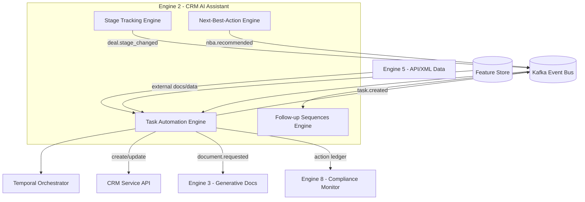
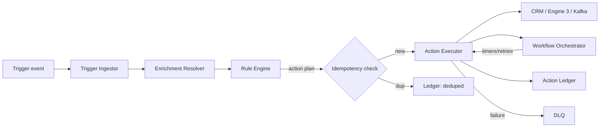
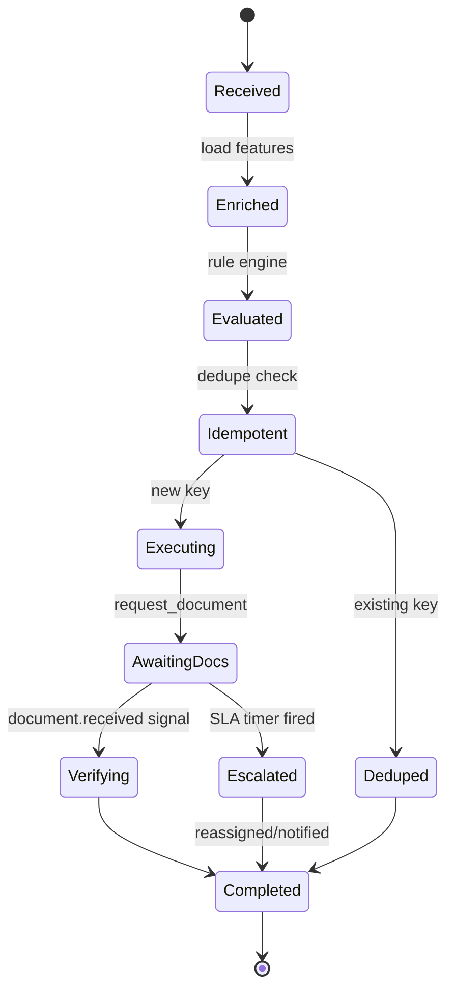
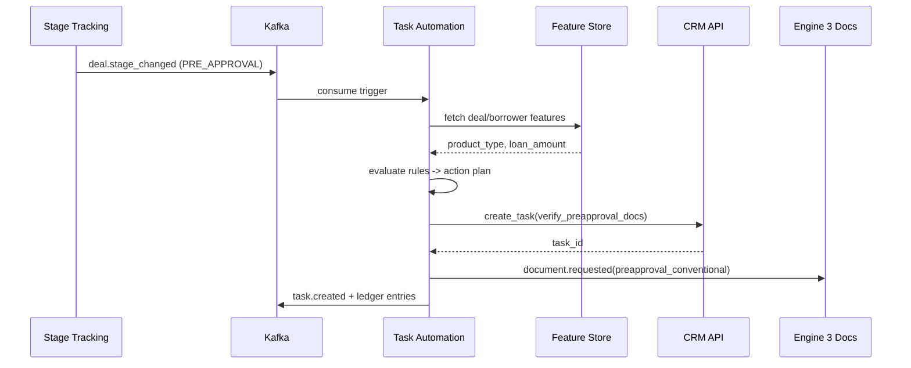

# Task Automation Engine (Ticket Description for Refrence)

Overview
Automatically generates, assigns, and schedules CRM tasks based on lead events, stage changes, or predefined workflow rules — ensuring agents always know what to do next without manually creating follow-up tasks. Prevents leads from being forgotten due to agent workload or oversight.
Goals
Guarantee no lead is missed due to human error or oversight
Standardize follow-up processes across all agents
Reduce cognitive load — agents focus on doing, not planning what to do
Maintain a full auditable activity trail per lead
Functional Requirements
Workflow rule builder: Trigger Event + Condition → Create Task (type, due date, assignee, priority)
Task types: call, WhatsApp, send email, send document, schedule meeting
Business-hours-aware due date calculation (no tasks due at odd hours)
Auto-assignment to the lead's responsible agent
Task queue per agent sorted by due date and priority
Overdue task visual alert (red badge)
Recurring task support
Task completion logging with outcome notes
Technical Notes
Rule storage: { trigger_event, conditions[], action_type, delay_hours, assignee, priority }
Cron/scheduler for time-based task generation
Conflict detection: avoid duplicate tasks of same type within short window
Integrate with calendar APIs for meeting-type tasks
Acceptance Criteria
Tasks are auto-created on defined trigger events correctly
Due date calculation respects business hours and time zones
Agents see pending tasks in their dashboard sorted by urgency
Overdue tasks display a visual alert
Managers can view task status across all agents
Task completion is logged with timestamp and outcome notes
Dependencies
Build Dependencies: None (standalone foundation engine — events from Stage Tracking and Lead Assignment can be mocked during development)
Runtime Data Integrations: Stage Tracking Engine (trigger events), Lead Assignment Engine (assignment events)
Feeds into: Follow-up Sequences Engine, Performance Analytics System, Next-Best-Action Engine


Subtasks

CEAAPSS-706
Vision
CEAAPSS-707
Project Requirements
CEAAPSS-708
Functional Requirement
CEAAPSS-709
System Architecture
CEAAPSS-710
System Design


# Task Automation Engine — Vision

## 1. Purpose & Mission
The **Task Automation Engine** is the execution arm of Engine 2 (CRM AI Assistant). Its mission is to turn CRM intent and domain events into **reliable, auditable, automated work** — creating tasks, updating records, requesting documents, and triggering downstream workflows — so loan officers (LOs), processors, and brokers spend their time on borrowers rather than on CRM bookkeeping.

It answers the operational question: *"Given everything that just happened on a deal, what work should be created, assigned, or completed automatically — and what still needs a human?"*

Where other Engine 2 sub-agents **decide** (Lead Scoring, Next-Best-Action) or **predict** (Forecasting, Churn), the Task Automation Engine **acts**: it is the deterministic-plus-LLM-assisted orchestrator that converts decisions and events into concrete, tracked CRM actions.

## 2. Problem Statement
Mortgage/loan operations are death by a thousand manual steps. Today on CRequity.ai's CRM:
- When a deal advances to "Pre-Approval," someone must remember to request pay stubs, order a credit pull request, create a borrower welcome task, and notify the processor.
- SLA-critical tasks (e.g., "collect appraisal docs within 48h") are tracked in LOs' heads and spreadsheets.
- Doc-request triggers fire late or not at all, stalling deals at exactly the stages where speed wins business.
- Record hygiene (stage fields, owner assignment, missing-data flags) is inconsistent, poisoning every downstream model.
- There is no consistent, replayable, audit-grade record of *which automation did what, when, and why* — a problem for SOC 2 and fair-lending reviews.

The result: leaked SLAs, slow deal velocity, inconsistent borrower experience, and unauditable automation logic scattered across point integrations.

## 3. Target Users & Stakeholders
| Stakeholder | Use of the engine |
|-------------|-------------------|
| Loan Officers | Receive auto-created, pre-populated tasks instead of manual checklists |
| Loan Processors | Get doc-request and verification tasks triggered on stage transitions |
| Sales/Ops Managers | Define automation rules, monitor SLA breach and task throughput |
| RevOps / CRM Admins | Author and version rule sets and workflow templates |
| Follow-up Sequences Engine (peer) | Consumes task events; enrolls contacts into cadences |
| Stage Tracking Engine (peer) | Emits stage transitions that this engine reacts to |
| Engine 3 (Generative Docs) | Receives `document.requested` to generate disclosures/letters |
| Compliance (Engine 8) | Audits automated actions; consumes the action ledger |

## 4. Value Proposition & Business Goals
- **Zero-touch CRM hygiene**: stage fields, ownership, and missing-data flags maintained automatically.
- **SLA enforcement by construction**: every stage transition spawns the right tasks with due dates and escalation.
- **Faster deal velocity**: doc requests and processor handoffs fire the instant a trigger condition is met.
- **Deterministic where it must be, intelligent where it helps**: rules engine for compliance-critical actions; LLM agents only for low-risk drafting/summarization under guardrails.
- **Full auditability**: every action emits an immutable ledger entry (rule id, inputs, actor, outcome) for SOC 2 and ECOA review.

## 5. Success Metrics & KPIs
| KPI | Target |
|-----|--------|
| Manual CRM task creations eliminated | ≥ 70% within 2 quarters |
| Stage-transition → task-created latency | p95 ≤ 3 s |
| Doc-request trigger accuracy (correct doc set per product/stage) | ≥ 99% |
| SLA-breach rate on automated tasks | ≤ 2% |
| Automation action success rate (no manual rework) | ≥ 97% |
| Idempotency violations (duplicate task/record writes) | 0 (hard guardrail) |
| Rule-evaluation throughput | ≥ 5,000 events/s sustained |
| Audit-ledger completeness (actions with full provenance) | 100% |
| LLM-agent action human-override rate | ≤ 5% (else rule promoted/retuned) |

## 6. Scope
**In Scope**
- Event- and schedule-triggered task creation, assignment, and completion.
- CRM record mutations (stage fields, owner, flags) via the CRM service API.
- Document-request orchestration (`document.requested` to Engine 3 / Engine 5).
- Rule authoring, versioning, simulation/dry-run, and rollout.
- Workflow orchestration (Temporal) for multi-step, long-running task chains.
- Optional LLM "task agents" for drafting task notes, summarizing, classifying — under approval guardrails.
- Idempotency, retry, dead-letter handling, and an immutable action ledger.

**Out of Scope**
- Multi-step *outreach cadences* to borrowers (owned by Follow-up Sequences Engine).
- Stage definition and SLA *policy* ownership (owned by Stage Tracking Engine; this engine *reacts*).
- Document *content generation* (Engine 3) and credit/underwriting decisions (Engines 1/4).
- Final compliance adjudication (Engine 8); this engine emits signals and enforces guardrails only.

## 7. Strategic Alignment
The Task Automation Engine is the **"hands" of Engine 2**. Decision sub-agents publish intents (`nba.recommended`, `lead.scored`) and the Stage Tracking Engine publishes `deal.stage_changed`; this engine converts them into governed, idempotent CRM actions and emits `task.created` / `record.updated` / `document.requested` for the rest of the platform. By centralizing automation behind a versioned rules engine plus auditable orchestration, it makes CRequity.ai's operations fast, consistent, and **defensible** — every automated action is explainable and replayable for SOC 2, GDPR/CCPA, and fair-lending (ECOA/Reg B) review, directly lowering operational cost-per-funded-loan.


# Task Automation Engine — Project Requirements

## 1. Overview
This document defines the requirements for the Task Automation Engine, the sub-agent of Engine 2 responsible for converting CRM events and decisions into automated, auditable tasks, record updates, and document requests. It combines a deterministic **rules engine**, a **workflow orchestrator** (Temporal) for long-running multi-step automations, and optional **LLM task agents** operating under strict guardrails.

## 2. Objectives
- Eliminate ≥70% of repetitive manual CRM task creation across the lending pipeline.
- Guarantee idempotent, replayable execution of every automated action.
- Provide a versioned, simulatable rule-authoring experience for non-engineers (RevOps).
- Enforce stage-driven SLAs through automatically generated, escalating tasks.
- Emit a complete, immutable action ledger for compliance and observability.

## 3. Stakeholders & Roles
| Role | Responsibility |
|------|----------------|
| Product Owner (CRM Automation) | Prioritizes rule library and roadmap |
| RevOps / CRM Admin | Authors, versions, and rolls out automation rules |
| Backend Engineers | Build rule engine, orchestration workers, connectors |
| ML/LLM Engineers | Build/guard LLM task agents and classifiers |
| SRE | Owns throughput, DLQ, latency SLOs |
| Compliance (Engine 8 liaison) | Reviews automated-action guardrails and ledger |
| Loan Officers / Processors | End consumers; provide feedback on task usefulness |

## 4. Functional Scope Summary
- Trigger management: event-driven (Kafka), schedule-driven (cron), and API-invoked.
- Rule engine: conditions (JSONLogic-style) → actions, with priorities and conflict resolution.
- Action library: create_task, assign_owner, update_record, request_document, post_note, start_workflow, emit_event.
- Workflow orchestration: durable multi-step automations with timers, retries, and compensation.
- LLM task agents: draft notes, classify free text, summarize threads — gated by confidence + human approval.
- Simulation/dry-run, audit ledger, idempotency, retries, and dead-letter handling.

## 5. Non-Functional Requirements
| NFR | Target / Constraint |
|-----|---------------------|
| Throughput | ≥ 5,000 trigger events/s sustained; 15,000/s burst |
| Action latency (event→action) | p95 ≤ 3 s, p99 ≤ 8 s |
| Availability | 99.9% monthly for action execution path |
| Idempotency | Exactly-once *effect* per (trigger_id, rule_id, action_key) |
| Durability | Workflow state survives pod restarts (Temporal persistence) |
| Scalability | Horizontal autoscale on Kafka consumer lag + CPU |
| Auditability | 100% of actions ledgered with provenance, retained ≥ 7 years |
| Security | PII encrypted at rest (AES-256) + in transit (TLS 1.2+); RBAC on rule authoring |
| Compliance | SOC 2, GDPR/CCPA data-minimization; ECOA-neutral automation features |
| Recoverability | DLQ replay within 1 click; RPO ≤ 1 min, RTO ≤ 15 min |
| Rule rollout safety | Mandatory dry-run + canary (1% traffic) before full enable |

## 6. Constraints & Assumptions
- **Constraints**: Must use platform Kafka, Temporal, Postgres, Redis; CRM mutations only via the CRM service API (no direct DB writes); LLM access only via the platform LLM provider abstraction.
- **Assumptions**: Stage Tracking Engine reliably emits `deal.stage_changed`; CRM service exposes idempotent write APIs; Engine 3 accepts `document.requested`; identity/RBAC is provided by platform IAM.

## 7. Dependencies
| Dependency | Type | Purpose |
|------------|------|---------|
| Kafka event bus | Platform | Trigger ingestion + action event emission |
| Temporal | Platform | Durable workflow orchestration |
| CRM Service API | Internal | Task/record/document mutations |
| Stage Tracking Engine | Peer | Source of stage-transition triggers |
| Engine 3 (Generative Docs) | Cross-engine | Fulfills document requests |
| Engine 5 (API/XML Data) | Cross-engine | External doc/data retrieval |
| LLM Provider Abstraction | Platform | Powers LLM task agents |
| Feature Store | Platform | Enrichment data for rule conditions |
| IAM / RBAC | Platform | Authoring + execution authorization |

## 8. Deliverables & Milestones
| Phase | Milestone | Deliverables |
|-------|-----------|--------------|
| P0 (Wk 1–3) | Foundations | Event schemas, action ledger, idempotency keys, CRM connector |
| P1 (Wk 4–7) | Rules MVP | Rule engine, condition DSL, create_task/update_record actions, dry-run |
| P2 (Wk 8–11) | Orchestration | Temporal workflows for doc-request chains + escalation timers |
| P3 (Wk 12–15) | Intelligence | LLM task agents (draft/classify) with guardrails + override capture |
| P4 (Wk 16–18) | Hardening | DLQ replay UI, canary rollout, load test to 15k/s, SOC 2 evidence |
| GA | Launch | Full rule library, runbooks, observability dashboards |

## 9. Risks & Mitigations
| Risk | Impact | Likelihood | Mitigation |
|------|--------|-----------|------------|
| Duplicate actions on event replay | High | Medium | Deterministic idempotency keys + ledger dedupe |
| Runaway rule loop (action triggers rule that re-triggers) | High | Medium | Cycle detection, per-deal action budget, loop guard |
| LLM agent takes wrong action | High | Low/Med | Confidence threshold + human approval for write actions |
| Rule misconfiguration mass-mutates records | Critical | Low | Mandatory dry-run + canary + blast-radius limit |
| Downstream API (Engine 3) outage | Medium | Medium | Temporal retry/backoff + DLQ + degraded mode |
| Fair-lending bias via automation features | High | Low | Feature governance review; exclude protected proxies |

## 10. Acceptance Criteria
- Given a `deal.stage_changed` to "Pre-Approval", the correct doc-request and processor tasks are created within p95 ≤ 3 s, exactly once, and ledgered with full provenance.
- A rule replayed from Kafka offset produces **no** duplicate side effects.
- A new rule cannot reach production without a passing dry-run and a ≥1% canary window.
- Every automated write action appears in the immutable ledger with rule id, inputs hash, actor, and outcome.
- An LLM task-agent write action is blocked unless confidence ≥ threshold **and** human approval is recorded.


# Task Automation Engine — Functional Requirements

## 1. Overview
This document specifies the functional behavior of the Task Automation Engine: how triggers are ingested, how rules and workflows evaluate them, and how automated actions (tasks, record updates, document requests) are produced, governed, and audited.

## 2. Actors
| Actor | Description |
|-------|-------------|
| CRM Admin / RevOps | Authors and versions automation rules and workflow templates |
| Loan Officer / Processor | Receives/acts on auto-created tasks; can override LLM-drafted content |
| System (Event Bus) | Emits domain events that act as triggers |
| Scheduler | Fires time-based triggers (cron, SLA timers) |
| Peer Sub-Agents | Publish intents consumed as triggers (NBA, Stage Tracking) |
| Compliance Reviewer | Reads action ledger; flags non-compliant automations |

## 3. Functional Requirements
| ID | Requirement | MoSCoW |
|----|-------------|--------|
| FR-001 | Ingest domain events from Kafka and map them to candidate rule sets | Must |
| FR-002 | Evaluate rule conditions using a JSONLogic-style DSL over event + enriched features | Must |
| FR-003 | Resolve rule conflicts by priority, then specificity, then deterministic tiebreak | Must |
| FR-004 | Execute `create_task` with template, assignee resolution, due date, and SLA | Must |
| FR-005 | Execute `update_record` (stage fields, owner, flags) via CRM service API | Must |
| FR-006 | Execute `request_document` emitting `document.requested` with required doc set | Must |
| FR-007 | Guarantee idempotent effects via (trigger_id, rule_id, action_key) keys | Must |
| FR-008 | Start durable Temporal workflows for multi-step automations | Must |
| FR-009 | Apply escalation timers and reassign/notify on SLA breach | Must |
| FR-010 | Provide dry-run/simulation returning the action set without side effects | Must |
| FR-011 | Write an immutable ledger entry per action with full provenance | Must |
| FR-012 | Support schedule-based triggers (cron) for recurring tasks | Should |
| FR-013 | LLM task agent drafts task notes / summaries with confidence score | Should |
| FR-014 | Require human approval for LLM-initiated write actions below trust threshold | Must |
| FR-015 | Detect and break automation loops via per-deal action budget | Must |
| FR-016 | Provide DLQ with one-click replay for failed actions | Should |
| FR-017 | Version rules with canary rollout (1% traffic) and instant rollback | Must |
| FR-018 | Expose REST API to trigger, simulate, and query automation runs | Must |
| FR-019 | Emit `task.completed` / `automation.failed` events for observability | Should |
| FR-020 | Allow per-tenant/branch rule scoping and feature-flagged enablement | Could |

## 4. User Stories
**US-1 — Stage-driven doc request**
> As a *processor*, when a deal moves to "Pre-Approval," I want the required document set auto-requested so I never chase missing pay stubs manually.
- **AC1**: On `deal.stage_changed{to: PRE_APPROVAL}`, a `document.requested` event lists the product-specific doc set (e.g., W-2, pay stubs, bank statements).
- **AC2**: A processor task "Verify pre-approval docs" is created with a 48h SLA and assigned to the deal's processor.
- **AC3**: Both actions are idempotent on event replay and ledgered.

**US-2 — Rule authoring with safety**
> As a *RevOps admin*, I want to dry-run a new rule against last 7 days of events so I can see its blast radius before enabling it.
- **AC1**: Dry-run returns count and sample of actions that *would* fire, with zero side effects.
- **AC2**: Enabling requires a canary at 1% before 100% rollout.

**US-3 — LLM-drafted note under guardrail**
> As a *loan officer*, I want auto-drafted call-summary notes I can approve in one click, but never auto-posted if the model is unsure.
- **AC1**: If LLM confidence < 0.85, the note is staged as "draft pending approval," not posted.
- **AC2**: Approvals/overrides are captured and emitted as feedback.

## 5. Inputs & Outputs
**Inputs**: domain events (`deal.stage_changed`, `lead.scored`, `nba.recommended`, `task.completed`), schedule triggers, enrichment features (deal product, loan amount, borrower flags), rule definitions, workflow templates.

**Outputs**: `task.created`, `record.updated`, `document.requested`, `automation.run.completed`, `automation.failed`, ledger entries, DLQ messages, REST responses (run status, simulation result).

## 6. Business Rules
- **BR-1**: Compliance-critical actions (disclosure requests, adverse-action timers) MUST use deterministic rules — never LLM-only.
- **BR-2**: No action may execute twice for the same idempotency key; the ledger is the source of truth.
- **BR-3**: A single trigger event may not produce more than the configured per-deal action budget (default 25) without escalation.
- **BR-4**: Assignee resolution falls back: explicit owner → deal owner → round-robin within branch → queue.
- **BR-5**: Automation features used in conditions must exclude protected-class proxies (ECOA/Reg B governance).
- **BR-6**: Document-request doc sets are derived from the product + stage matrix, not free-form.

## 7. Integration Points & APIs
**Consumed events**: `deal.stage_changed`, `lead.scored`, `nba.recommended`, `task.completed`, `document.received`.
**Produced events**: `task.created`, `task.updated`, `record.updated`, `document.requested`, `automation.run.completed`, `automation.failed`.
**REST (via API gateway)**:
- `POST /automation/v1/triggers` — fire an ad-hoc trigger.
- `POST /automation/v1/rules/{id}/simulate` — dry-run a rule.
- `GET /automation/v1/runs/{runId}` — run status + action ledger.
- `POST /automation/v1/rules` / `PATCH .../{id}` — author/version rules.

## 8. Error Handling & Edge Cases
- **CRM write failure**: retry with exponential backoff (Temporal); after N retries → DLQ + `automation.failed`.
- **Duplicate event**: idempotency key short-circuits; ledger records "deduped."
- **Conflicting rules**: highest priority wins; conflict logged; both recorded in ledger for audit.
- **Missing enrichment feature**: rule conditions referencing it evaluate as false (fail-safe), not error.
- **Loop detected**: action budget exceeded → halt, raise `automation.loop_detected`, notify ops.
- **LLM timeout/low confidence**: degrade to "draft pending approval" or skip; never block the deterministic path.
- **Downstream (Engine 3) unavailable**: workflow parks with timer, retries, surfaces degraded status.


# Task Automation Engine — System Architecture

## 1. Architecture Overview & Principles
The Task Automation Engine is an event-driven microservice that ingests triggers, evaluates a versioned rule engine, orchestrates durable workflows, and emits governed CRM actions. Core principles:
- **Deterministic-first**: compliance-critical actions are rule-driven; LLM is additive and guarded.
- **Idempotent effects**: every action keyed and ledgered; replays are safe.
- **Durable orchestration**: long-running, multi-step automations survive failures via Temporal.
- **Separation of decision and action**: peers decide; this engine acts and records.
- **Auditable by design**: immutable action ledger for SOC 2 / ECOA.

## 2. Context Diagram


## 3. Component Breakdown
| Component | Responsibility |
|-----------|----------------|
| Trigger Ingestor | Consumes Kafka topics + schedule triggers; normalizes to canonical trigger envelope |
| Enrichment Resolver | Fetches deal/borrower features from Feature Store + CRM read API |
| Rule Engine | Evaluates condition DSL, resolves conflicts, emits action plan |
| Action Executor | Performs create_task/update_record/request_document via connectors |
| Workflow Orchestrator | Runs durable Temporal workflows for multi-step + timer-based automations |
| LLM Task Agent | Drafts notes/classifies text under confidence + approval guardrails |
| Idempotency Store | Redis-backed dedupe keyed by (trigger_id, rule_id, action_key) |
| Action Ledger | Append-only Postgres table + event stream for audit |
| Rule Registry | Versioned rule/workflow definitions with canary metadata |
| DLQ Manager | Captures failures; supports replay |

## 4. Data Flow


## 5. Technology Stack
| Layer | Technology |
|-------|------------|
| Language/Runtime | Go (executor/ingestor), Python (LLM agent) |
| Messaging | Apache Kafka |
| Orchestration | Temporal |
| Rule DSL | JSONLogic-style engine (CEL-compatible) |
| Datastores | Postgres (ledger/registry), Redis (idempotency, cache) |
| LLM | Platform LLM provider abstraction |
| API | REST via API gateway (gRPC internal) |
| Deploy | Kubernetes + HPA, Helm |
| Observability | OpenTelemetry, Prometheus, Grafana, Loki |

## 6. Integration & Messaging
- **Consumed topics**: `deal.stage_changed`, `lead.scored`, `nba.recommended`, `task.completed`, `document.received`.
- **Produced topics**: `task.created`, `record.updated`, `document.requested`, `automation.run.completed`, `automation.failed`.
- **Workflow engine**: Temporal namespaces per environment; activities wrap connectors with retry policies; signals handle async doc receipt.
- **API gateway**: authenticates rule-authoring + simulation endpoints with RBAC scopes (`automation.rules.write`).
- **Partitioning**: Kafka keyed by `deal_id` to preserve per-deal ordering and enable loop budget.

## 7. Data Stores & Feature Store
- **Postgres**: `action_ledger`, `rule_registry`, `workflow_runs`, `task_index` (read model).
- **Redis**: idempotency keys (TTL 7d), assignee round-robin counters, hot rule cache.
- **Feature Store**: deal/borrower features (product type, loan amount, stage age, missing-doc flags) for rule conditions.
- **Object storage (S3)**: large simulation reports and exported ledger snapshots.

## 8. Security & Compliance Boundaries
- CRM mutations only through the CRM service API with scoped service credentials (no direct DB).
- PII minimized in events (IDs + necessary fields only); encrypted in transit/at rest.
- Rule-authoring gated by RBAC; all rule changes versioned and audit-logged.
- Action ledger is append-only, immutable, retained ≥7 years, streamed to Engine 8.
- Automation features governed to exclude protected-class proxies (ECOA/Reg B).

## 9. Scalability & Deployment
- Stateless executors autoscaled on Kafka consumer lag + CPU; Temporal workers scale independently.
- Per-deal ordering via partition keys; action budget bounds blast radius.
- Canary rollout (1% by partition hash) for new rule versions; instant rollback flag.
- Multi-AZ Kubernetes; Postgres HA (primary + replicas); Redis cluster.

## 10. Observability
- Golden signals: event lag, action latency (p95/p99), action success rate, DLQ depth.
- Per-rule dashboards: fire count, dedupe rate, override rate, SLA-breach count.
- Distributed tracing across ingest → rule → action → CRM/Engine 3.
- Alerts: consumer lag > threshold, DLQ growth, idempotency-violation (should be 0), loop detections.


# Task Automation Engine — System Design

## 1. Detailed Component Design
**Trigger Ingestor** — Kafka consumer group + scheduler. Wraps each input in a canonical envelope `{trigger_id, type, deal_id, payload, occurred_at, source}`. Deduplicates at the source using event id.

**Rule Engine** — Loads active rule versions from the registry into memory (hot cache in Redis). For each trigger, selects candidate rules by `event_type`, evaluates conditions (CEL/JSONLogic) against the enriched context, and produces an ordered **action plan**. Conflict resolution: priority desc → specificity (number of matched conditions) → rule_id.

**Action Executor** — Translates each action into a connector call wrapped in a Temporal activity. Computes the idempotency key, checks the Idempotency Store, executes, and writes the ledger entry.

**LLM Task Agent** — Stateless Python service. Given a prompt template + context, returns drafted text + confidence. Write actions require confidence ≥ threshold AND human approval; otherwise staged as draft.

**Workflow Orchestrator** — Temporal workflows model multi-step chains (e.g., request docs → wait for `document.received` signal → verify → advance task) with timers and compensation.

## 2. Data Models & Schemas
```sql
CREATE TABLE rule_registry (
  rule_id        UUID PRIMARY KEY,
  name           TEXT NOT NULL,
  version        INT  NOT NULL,
  event_types    TEXT[] NOT NULL,
  conditions     JSONB NOT NULL,         -- CEL/JSONLogic expression tree
  actions        JSONB NOT NULL,         -- ordered action list
  priority       INT  NOT NULL DEFAULT 100,
  status         TEXT NOT NULL,          -- draft|canary|active|disabled
  canary_pct     NUMERIC DEFAULT 0,
  created_by     TEXT NOT NULL,
  created_at     TIMESTAMPTZ DEFAULT now(),
  UNIQUE (name, version)
);

CREATE TABLE action_ledger (
  ledger_id      BIGSERIAL PRIMARY KEY,
  trigger_id     UUID NOT NULL,
  rule_id        UUID,
  action_type    TEXT NOT NULL,          -- create_task|update_record|request_document|...
  action_key     TEXT NOT NULL,          -- idempotency component
  deal_id        UUID,
  inputs_hash    TEXT NOT NULL,
  outcome        TEXT NOT NULL,          -- executed|deduped|failed
  actor          TEXT NOT NULL,          -- system|llm_agent|rule:<id>
  detail         JSONB,
  created_at     TIMESTAMPTZ DEFAULT now(),
  UNIQUE (trigger_id, rule_id, action_key)
);
```

JSON example of a rule definition:
```json
{
  "rule_id": "9f1c...",
  "name": "preapproval_doc_request",
  "version": 3,
  "event_types": ["deal.stage_changed"],
  "conditions": {
    "and": [
      {"==": [{"var": "payload.to_stage"}, "PRE_APPROVAL"]},
      {"in": [{"var": "features.product_type"}, ["CONVENTIONAL", "FHA"]]}
    ]
  },
  "actions": [
    {"type": "request_document", "doc_set": "preapproval_conventional"},
    {"type": "create_task", "template": "verify_preapproval_docs",
     "assignee": "deal.processor", "sla_hours": 48}
  ],
  "priority": 200
}
```

## 3. API Specification
**Simulate a rule (dry-run)**
```
POST /automation/v1/rules/{ruleId}/simulate
{
  "lookback_days": 7,
  "sample_size": 50
}
```
Response:
```json
{
  "rule_id": "9f1c...",
  "would_fire_count": 412,
  "sample_actions": [
    {"deal_id": "d-101", "action_type": "request_document", "doc_set": "preapproval_conventional"},
    {"deal_id": "d-101", "action_type": "create_task", "template": "verify_preapproval_docs", "sla_hours": 48}
  ],
  "blast_radius_warning": false
}
```

**Get a run**
```
GET /automation/v1/runs/{runId}
```
```json
{
  "run_id": "r-77",
  "trigger": {"type": "deal.stage_changed", "deal_id": "d-101"},
  "actions": [
    {"action_type": "request_document", "outcome": "executed", "ledger_id": 90211},
    {"action_type": "create_task", "outcome": "executed", "task_id": "t-555"}
  ],
  "status": "completed"
}
```

## 4. Workflow / Orchestration Design
Rule-to-action evaluation is deterministic; multi-step automations run as Temporal workflows.



Loop guard: a per-deal counter in Redis increments on each action; exceeding the budget (default 25) halts execution and emits `automation.loop_detected`.

## 5. Sequence Diagram


## 6. Database / Storage Schema
- **Postgres**: `rule_registry`, `action_ledger`, `workflow_runs(run_id, deal_id, status, started_at)`, `task_index(task_id, deal_id, status, sla_due_at)`.
- **Redis**: `idem:{trigger_id}:{rule_id}:{action_key}` (TTL 7d), `loopbudget:{deal_id}` (TTL 1h), assignee round-robin counters.
- **S3**: simulation reports, ledger export snapshots (compliance).

## 7. Configuration & Parameters
| Parameter | Default | Purpose |
|-----------|---------|---------|
| `per_deal_action_budget` | 25 | Loop protection |
| `llm_confidence_threshold` | 0.85 | Gate LLM write actions |
| `default_task_sla_hours` | 48 | Fallback SLA |
| `canary_pct` | 1 | Initial rollout share |
| `retry_max_attempts` | 5 | Activity retry policy |
| `idempotency_ttl_days` | 7 | Dedupe window |

## 8. Testing Strategy
- **Unit**: condition DSL evaluation, conflict resolution, idempotency key derivation.
- **Contract**: event schema + CRM/Engine 3 API contracts (Pact).
- **Replay tests**: re-emit the same event N times → assert exactly-once effects.
- **Workflow tests**: Temporal test framework for timers, signals, compensation.
- **Load**: 15k events/s burst; assert p95 ≤ 3 s.
- **Guardrail tests**: LLM low-confidence path stages draft, never auto-writes.
- **Compliance**: assert no protected-class proxy features referenced in active rules.

## 9. Performance & Reliability Considerations
- In-memory rule cache with versioned invalidation avoids per-event registry reads.
- Connector calls wrapped as idempotent Temporal activities with backoff + jitter.
- DLQ with one-click replay; poison-message quarantine after N failures.
- Per-deal partitioning preserves ordering; action budget bounds blast radius.
- Graceful degradation: if LLM/Engine 3 down, deterministic actions still complete; dependent steps park on timers.


